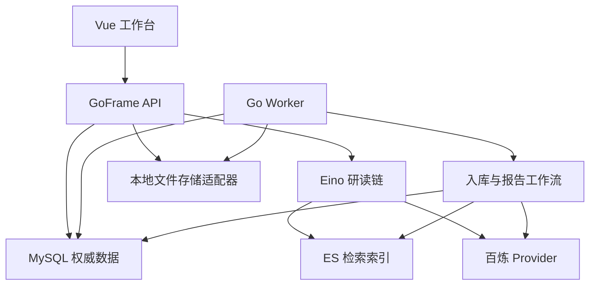
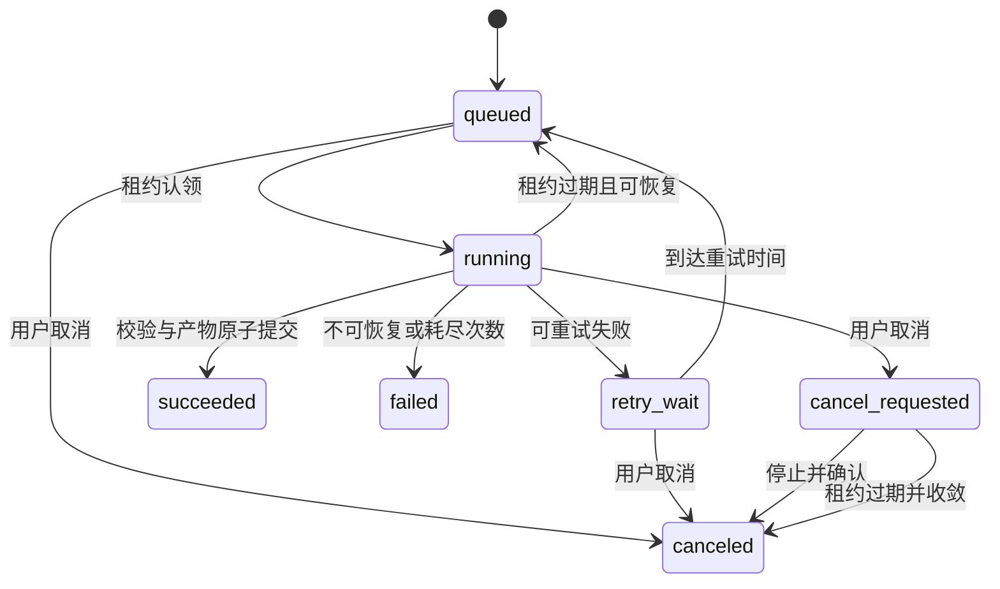

# go-rag → PaperDesk 改进方案 v1.1.1

> 编制日期：2026-10-13（UTC+8）。
> 文档性质：供用户、Qoder 与复核 Agent 使用的设计基线；本次完成静态源码核对与官方资料检索，尚未编译、运行服务、调用模型或实施改造。v1.1 基于 v1.0 独立复核后修订，修正事实表述、补齐实施契约、细化 Stage 分批。v1.1.1 基于 v1.1 复核后微调，修正 BlobStore 并发安全、旧数据映射隔离、Stage 0 只读边界、测试命令覆盖、LocatorAccuracy 统一、来源删除并发竞争、工时合计、F11 清单、依赖矩阵 API 名称等 12 项问题。
> 当前阶段：设计完成，待按 Stage 0 开始只读核对。文档中的新文件、接口、表、命令和指标均为设计目标，不能写成已经实现或验证。
> 场景沿用本对话提出的 PaperDesk：论文研读与文献对比工作台。仓库名称暂定 `paperdesk-go`，产品名、模型具体版本和排期估算允许在实施前修订。

## 复核采纳与修正说明（v1.1 新增）

v1.1 基于对 v1.0 的独立设计复核（核对本地 commit `0a1b52a` 源码与 v1.0 上传 zip 快照）产生。以下区分已确认事实、快照差异、待核实判断和设计决策。

### 已确认事实（本地 commit 0a1b52a 与 v1.0 描述一致）

- F01～F05、F07～F09、F12、F14、F15 的问题描述与源码一致，修复阶段安排合理。
- 项目确实同时存在 GoFrame CLI 自动生成的 DAO（12 个生成文件）和手写 GORM 模型（`internal/model/gorm/`）。
- 项目确实无持久化任务队列，异步处理依赖 goroutine。
- Eino 核心包声明版本为 v0.6.0，无 replace 指令，无 go.work 配置。

### 快照差异（v1.0 zip 与本地 commit 不完全相同）

- v1.0 基于上传的 `go-rag-main.zip`（SHA-256: `7d9ce9...`），本地工作区 HEAD 为 `0a1b52a`（含后续 docs 提交）。
- 核心业务代码在两份快照中一致——此为 Qoder 报告的待核实结论，尚未通过文件清单和 SHA-256 逐文件对比独立验证。Stage 0 应通过 `diff` 或文件 hash 对比确认。未执行比对的部分不能写成本轮已独立验证的事实。需对照的快照路径：v1.0 基于 `go-rag-main.zip`（SHA-256: `7d9ce9...`），本地 HEAD 为 `0a1b52a`。
- 本复核中涉及的源码核查均基于本地 commit `0a1b52a`，标注行号以此为基准。

### 需修正的表述（v1.1 已修正）

| 原 v1.0 表述 | 修正后 | 证据 |
|---|---|---|
| F06："URL 导入 nil 访问" | 改为"请求路径 nil 访问风险"，是否导致进程退出取决于恢复机制 | `rag_v1_indexer.go:29` 在 `if req.File != nil` 块外访问 `req.File.Filename`；GoFrame 不自动拦截，触发 panic 取决于框架中间件 |
| F10："MD 合并使用 `len`" | 明确为 `len(string)` 返回字节数，阈值 512 单位为字节 | `merge.go` 第 42 行 `len(nd.Content)+len(doc.Content) > maxLen`，Go `len(string)` 返回字节数 |
| F11："ES/Qdrant 多处写死1024维" | 列出实际 14 处 Embedding 维度硬编码位置，不使用"替换模型必然不一致"等绝对结论 | 分布在 `config/helpers.go`、`common/es.go`、`vector/es.go`、`vector/qdrant.go`、`common/embedding.go`、`indexer/indexer.go`、`indexer/indexer_async.go` 等文件 |
| F13："EsHit2Document 遇未知字段返回错误" | 明确为 ES `_source` 顶层字段白名单解码，非 ext 子字段解析 | `retriever.go:65-106` 和 `config/helpers.go:271-311` 使用 sonic 反序列化 `_source`，switch 白名单匹配，default 分支返回错误 |
| 旧数据映射："knowledge_documents.ext" | 删除此错误引用，ext 字段仅存在于 knowledge_chunks 表 | 核查 `entity/knowledge_documents.go`、`gorm/knowledge_documents.go` 均无 ext 字段 |
| chat-history："无社区维护" | 改为"版本较早（v0.0.1），接口可能不足，列为待 Stage 0 核查的风险" | 该包存在于 go.sum，作者与项目同一人；"无社区维护"缺乏量化依据 |

### 待核实判断（须 Stage 0 验证）

- Eino v0.6.0 与各 eino-ext 伪版本的实际兼容性（伪版本时间戳不是不兼容证明）。
- chat-history 包的完整接口是否满足 PaperDesk 会话模型需求。
- MySQL 8.0 镜像版本是否支持 `FOR UPDATE SKIP LOCKED`。
- 百炼 Chat/Embedding/Rerank 的实际 endpoint 和响应格式。

### 设计决策（v1.1 新增或调整）

- DAO 策略：保持 GoFrame DAO/gdb 为业务权威访问，显式 SQL 迁移管理表结构，GORM AutoMigrate 逐步退出启动路径。
- Eino 版本策略：基础版保持 Stage 0 核验后确认可用的依赖组合，不为追新主动升级。
- chat-history：Stage 0 完整接口核查，形成能力差距表；不满足契约时通过适配器过渡或替换使用路径。
- Stage 1 新增 F06 优先修复小批次。
- Stage 3 的 3A 拆为 3A-1（设计）和 3A-2（实施）。
- Stage 4 先独立验证任务引擎，再接真实 Parser/ES。

## 0. 阅读与执行方法

本方案分为普通改造与增量扩展两层。Stage 0～8 组成一个能够演示、评测和继续维护的基础产品；Stage E1～E7 是基础完成后按价值选择的扩展，不要求全部实现。

每个 Stage 都采用以下顺序：读取事实源 → 提交该 Stage 的细化计划 → 用户审批修改范围 → 分批实施 → 运行对应检查 → Review diff → 记录证据 → 决定是否进入下一 Stage。用户已经明确授权的批次无需反复请求审批；授权设计文档不等于授权执行所有后续改动。

执行本方案时先读 §1～§6，再从 §7 的当前 Stage 进入。接口和数据不变量在 §4～§6，测试与交付标准在 §10～§13，增量技术研判在 §8～§9，检索依据在 §14。

### 0.1 结论与范围

- 改造底座：`wangle201210/go-rag`，沿用 GoFrame、Eino、MySQL、Elasticsearch 和 Vue。
- 核心业务：研究专题 → 导入论文 → 限定论文研读 → 选择对比维度 → 后台生成对比报告 → 查看证据并修订报告。
- 第一版运行形态：单用户、本地使用；API 与 Worker 可作为两个进程运行，研发阶段支持 `all` 模式。单用户专题隔离不能描述为多租户权限隔离。
- 普通改造重点：Go 并发与 context、可靠任务、来源快照、结构化输出、证据验证、测试与评测。
- 最值得优先追加的技术：OpenTelemetry、结构化 PDF 解析、Eino 工具 Agent。Asynq、人工介入恢复按时间选择。
- 第一版不安排：自动大规模论文搜索、自动判定论文创新性、自动替用户选择研究方向、微服务拆分、GraphRAG、模型训练。

### 0.2 与 Java 项目的关系

| 项目 | 面向对象 | 业务重点 | 主要可展示成果 |
|---|---|---|---|
| Java DevSupport | 研发人员 | 项目资料查询、环境/版本相关问题、故障排查 | Spring 后端与有依据的排查链 |
| Go PaperDesk | 研究生、小型研究项目中的资料使用者 | 单篇研读、限定文献对比、异步报告 | Eino 编排、Go 并发、任务恢复、来源快照 |

Java 项目已有的评测方法可以迁移为设计经验，不能直接把 Java 的语料、gold、指标数值或验证结论当作 Go 项目的测试证据。

## 1. 项目选择与源码事实源

### 1.1 继承此前筛选结论

历史对话"检索Go AI项目"的源码筛选路线是 `go-rag → gopherai`。本次继续采用 go-rag 为主项目；gopherai 作为后续 Agent、Outbox/Worker、任务恢复的参考，ORAG 作为检索工程的进阶参考。参考其他项目时先核对许可证、版本和真实实现，不整包搬运。

go-rag 有真实的 HTTP、文档入库、RAG 与前端，规模适合渐进改造；本次上传快照后端包含 105 个 `.go` 文件、约 7,520 行（含测试和空行），46 个 Go 文件引用 Eino。数量只是规模说明，不代表代码质量或功能全部可用。[S01]

### 1.2 本轮采用的快照

| 项目 | 事实 |
|---|---|
| 主事实源 | 本次上传的 `go-rag-main.zip` |
| SHA-256 | `7d9ce99c637fd9661cb8f7e1e80377941f2c131b04fdc077d68d403e88d3e4ee` |
| 辅助比较包 | `go与python候选项目压缩包.zip` |
| 辅助包 SHA-256 | `d90d9cac2698f6e9944b1ae0386211797ff3c655a9aef81a0c7500cf5df130fb` |
| Go module | `github.com/wangle201210/go-rag/server` |
| `go.mod` 声明 | `go 1.23.1`，不代表必须使用这个旧工具链 |
| Eino | `v0.6.0` |
| GoFrame | `v2.9.0` |
| GORM | `v1.30.0` |
| ES Go client | `v8.16.0` |
| 前端 | Vue 3、Vite；`packageManager: pnpm@9.15.0` |
| 默认 Compose | 应用使用预构建 `iwangle/go-rag:v0.0.3`，ES 镜像 `8.11.3`，MySQL `8.0` |
| 项目规则文件 | 主源码包内未发现 `AGENTS.md`/`CLAUDE.md`；实施时以实际工作区为准 |

两份 Go 源码副本不能混用为同一个已锁定版本。Stage 0 在用户实际工作区重新记录 HEAD、diff、工具链、依赖和镜像版本。上游网页用于技术依据，不覆盖本次源码快照。

### 1.2.1 Eino 版本策略与依赖矩阵（v1.1 新增）

基础版默认保持 Stage 0 核验后确认可用的依赖组合，不为追新主动升级 Eino 核心版本。若现有组合存在实际兼容阻塞（如 eino-ext 组件要求更高版本的 Eino API），提出最小修正专批，不强行锁住一套不能构建的组合。

**核查计划（Stage 0 执行）：**

1. `go.mod` 直接声明版本：Eino `v0.6.0`，eino-ext 各组件伪版本号。
2. `go list -m -json all`：实际 selected module versions，确认无 replace/vendor/go.work 影响。
3. `go mod graph | grep eino`：各 eino-ext 组件对 Eino 核心的依赖要求。
4. 对应源码 API：检查项目中实际使用的 Eino API（compose.Graph、compose.Runnable、schema.Document 等）在选定版本中是否可用。
5. Go 工具链要求：确认 `go 1.23.1` 声明与本机 Go 版本兼容。

**依赖矩阵（待 Stage 0 核验填充）：**

| 模块 | 声明版本 | 实际解析版本 | 相关 API | 证据 | 待核实项 |
|---|---|---|---|---|---|
| Eino 核心 | v0.6.0 | 源码声明版本，待 Stage 0 核验 | compose.Graph/Runnable, schema.Document/Message, prompt.ChatTemplate | go.mod 第9行 | `go list -m -json` 确认 |
| eino-ext/embedding/openai | v0.0.0-20251202024135-b0f57b984d19 | 源码声明版本，待 Stage 0 核验 | `openai.NewEmbedder` | go.mod 第17行；`core/common/embedding.go:34` 调用 | 对 Eino 核心版本要求 |
| eino-ext/model/openai | v0.1.6-0.20251202024135-b0f57b984d19 | 源码声明版本，待 Stage 0 核验 | `openai.NewChatModel` | go.mod 第20行；`core/common/chat_model.go` 调用 | 对 Eino 核心版本要求 |
| eino-ext/indexer/es8 | v0.0.0-20250610035057-2c4e7c8488a5 | 源码声明版本，待 Stage 0 核验 | `es8.NewIndexer` | go.mod 第18行；`core/indexer/indexer.go:63` 调用 | 对 Eino 核心版本要求 |
| eino-ext/retriever/es8 | v0.0.0-20250610035057-2c4e7c8488a5 | 源码声明版本，待 Stage 0 核验 | `es8.NewRetriever` | go.mod 第22行；`core/retriever/retriever.go:43` 调用 | 对 Eino 核心版本要求 |
| eino-ext/indexer/qdrant | v0.0.0-20251107064029-2e128d3d2258 | 源码声明版本，待 Stage 0 核验 | Qdrant Indexer 构造 | go.mod 第19行 | 对 Eino 核心版本要求 |
| eino-ext/document/parser/pdf | v0.0.0-20250424061409-ccd60fbc7c1c | 源码声明版本，待 Stage 0 核验 | `pdf.NewPDFParser` | go.mod 第13行；`core/indexer/parser.go:25` 调用 | 对 Eino 核心版本要求 |
| eino-ext/document/transformer/splitter/markdown | v0.0.0-20250610035057-2c4e7c8488a5 | 源码声明版本，待 Stage 0 核验 | `markdown.NewHeaderSplitter` | go.mod 第15行；`core/indexer/transformer.go:27` 调用 | 对 Eino 核心版本要求 |

注：版本解析结论仅基于 go.mod/go.sum 声明。实际 Minimal Version Selection 解析版本须 Stage 0 通过 `go list -m -json` 核实。表中"源码声明版本"指 go.mod 中直接声明的版本字符串，不代表已验证与 Eino v0.6.0 运行时兼容。

**E4 之前的 Agent 能力核查：**

在 Stage E4（Eino 工具 Agent）启动前，核查当前 Eino v0.6.0 是否已具备所需的工具 Agent 能力（如 ReAct、ToolNode 等）。若已具备，E4-0 专批可简化；若确需升级，单列 E4-0 批次，按目标 tag 核查官方迁移说明、影响文件及验证计划。不要求升级至"最新稳定版"。

固定 Workflow（Stage 6 对比报告）、MCP 工具（已有基础）和 Agent（E4）是三种不同能力层级。如最终取消 Agent 扩展，应如实调整交付描述与简历表述，不用"Workflow+MCP 达到 Agent 效果"等不等价替代。

### 1.3 已存在的功能：复用而非重新包装为新增成果

| 已有能力 | 源码入口 | 改造方向 |
|---|---|---|
| 文件/URL 导入 | `server/internal/controller/rag/rag_v1_indexer.go`；`server/core/indexer.go` | 论文导入、来源快照、持久化任务 |
| Loader→切块→Indexer | `server/core/indexer/orchestration.go` | 保留 Eino 编排，增加规范化来源与发布步骤 |
| MD/PDF/HTML/XLSX 解析 | `server/core/indexer/parser.go`、`transformer.go`、`merge.go` | 第一版只承诺 PDF/MD/TXT，核对可追溯定位 |
| QA 生成与 QA 向量 | `server/core/indexer/qa.go`、`async.go`、`indexer_async.go` | 作为可关闭的检索增强，不是原文证据 |
| 内容向量+QA向量+ES BM25 | `server/core/retriever.go`、`core/retriever/bm25_retriever.go` | 统一论文范围、保留原始问题、控制费用 |
| RRF | `server/core/retriever/rrf.go` | 保留应用侧融合，验证去重与稳定排序 |
| Rerank | `server/core/rerank/rerank.go` | Provider 适配、超时、响应校验、显式降级 |
| 查询改写 | `server/core/message.go`、`core/common/chat_model.go` | 从固定三轮改为可配置策略 |
| 流式问答和历史 | `server/internal/logic/chat/`；`server/core/common/stream.go` | 规范 SSE、消息状态、取消、来源绑定 |
| 多存储实现 | `server/core/vector/`、`internal/dao/db/` | 正式验收只覆盖 MySQL+ES；另两种保留但不声称兼容已验证 |
| MCP | `server/internal/mcp/`、`internal/cmd/cmd.go` | 以后增加论文领域只读工具 |
| 网页搜索 | `server/core/websearch/` | 第一版默认关闭，资料来源只来自用户选定集合 |

RRF、BM25、Rerank、MCP 和 Eino 已存在。简历可以说明"基于已有能力改造并验证了什么"，不能称这些能力全部由自己从零实现。

### 1.4 已发现的静态问题与实施安排

下表是静态事实/风险，不是本轮运行得出的失败记录。

| 编号 | 位置与现象 | 可能影响 | 修复阶段 |
|---|---|---|---|
| F01 | `core/retriever.go: Retrieve` 在循环中修改 `req.optQuery`，协程内才执行 `req.copy()`；多协程写函数级 `err` | 查询与结果绑定错误、数据竞争 | Stage 1 |
| F02 | `core/indexer.go: Index` 的异步闭包写外部 `err` | 返回和后台写入之间存在竞争风险 | Stage 1 |
| F03 | `internal/logic/chat/chat.go: GetAnswerStream` 将请求 ctx 替换为 `context.Background()` | 用户取消后模型/保存协程继续工作 | Stage 1、5 |
| F04 | `core/common/stream.go` 读流失败后仍发 `[DONE]` 并返回 nil；Controller 建流失败可返回空成功 | 前端与持久化状态无法准确区分成功和失败 | Stage 1、5 |
| F05 | `core/rerank/rerank.go` 使用未绑定 ctx 的 HTTP request；未完整验证状态码、大小、结果下标 | 超时失控、异常响应造成错误或 panic | Stage 1、2 |
| F06 | 上传接口允许 URL，但无文件时在 `rag_v1_indexer.go:29` 仍读取 `req.File.Filename`，该访问不在 nil 检查保护范围内 | 请求路径 nil 访问风险；是否导致进程退出取决于框架恢复机制，未经运行验证不宣称必然行为 | Stage 1 优先修复；第一版仅 File 导入 |
| F07 | `core/indexer.go` 依赖后台 goroutine 和 sleep 后读取 ES，重启时没有持久化任务 | 入库/QA不完整、状态悬挂 | Stage 1止损、Stage 3/4替换 |
| F08 | `core/indexer/qa.go` 为每个 Chunk 启协程；失败仅记日志 | API 并发与费用缺乏上限、成功口径不清 | Stage 1、2、4 |
| F09 | `internal/logic/knowledge/chunks.go` 部分写入失败仍返回 nil；随后可能设为 Active | 局部失败被成功状态覆盖 | Stage 1、4 |
| F10 | `core/indexer/merge.go` 随机 UUID；MD 合并使用 `len(string)` 返回字节数（阈值 512 字节）；当前解析未证实保留页码 | 重试重复入库、切块口径以字节计不利于跨语言复现、引用定位不足 | Stage 3/4 |
| F11 | Embedding 维度 1024 散布 13 处（`config/helpers.go` 4处、`common/es.go` 2处、`common/embedding.go` 1处、`vector/es.go` 2处、`vector/qdrant.go` 2处、`indexer/indexer.go` 1处、`indexer/indexer_async.go` 1处）；Provider 初始化存在多入口与全局缓存 | 替换 Embedding 模型时若维度不同需逐处修改，存在遗漏风险 | Stage 2 |
| F12 | `dao.init` 会连接和 AutoMigrate，chat 初始化依赖配置；现有 `core/rag_test.go` 调真实 ES/模型 | 默认 `go test ./...` 并非确定性离线检查 | Stage 0/1 |
| F13 | ES `_source` 顶层字段使用 sonic 白名单解码（`EsHit2Document`/`esHit2Document`），新增字段未加入 switch 时 default 分支返回错误 | 业务元数据添加后若不同步更新解码白名单，检索结果解析失败 | Stage 3 |
| F14 | Chunk编辑会异步更新向量；论文删除跨 SQL/ES 无统一发布/恢复协议 | 原文与向量不一致、删除残留 | Stage 3/4 |
| F15 | 默认 Compose跑旧镜像；没有完善的上传文件持久化挂载 | 实际运行的不是修改源码，重建后文件丢失 | Stage 0、8 |

新增字段时同时核对 `core/config/helpers.go`、Eino indexer/retriever、`core/vector/` 和旧接口，不只修改 `VectorStore` 一处。

## 2. 改造后的使用场景

### 2.1 目标用户与边界

第一版面向单个研究者，支持管理多个研究专题。用户自己决定研究目标、纳入哪些论文、采用哪些对比维度；系统帮助定位证据、整理结论和生成报告。

论文"可用性""无监督程度""已知类别数依赖"等可以作为结构化研读字段，但模型产出必须展示依据和不确定性；没有找到证据不能自动写成"不存在"。不把模型意见直接当作论文筛选裁决。

第一版只支持文字可提取的 PDF、MD、TXT。扫描件、双栏阅读顺序错误、复杂公式与表格缺失都通过解析质量状态呈现；暂时无法解析的资料可以上传经用户核对的 MD/TXT替代材料，并保留它与原PDF的关联。

### 2.2 四个典型用户故事

**U1：建立专题并导入论文。** 用户创建"图聚类结构学习"，上传三篇论文；页面显示等待、解析、建索引或失败，成功后可查看文档版本与原文块。重复上传相同文件时提示已有论文，不重复产生一套入库任务。

**U2：单篇研读。** 用户选择论文A，提问"训练目标包含哪些损失？已知类别数在哪里使用？"。系统返回结论、证据片段、论文版本和章节/页码（存在时），未说明的内容标注"现有资料未找到"。

**U3：跨论文对比。** 用户选择A/B/C，维度为"图构建、训练目标、标签使用、类别数、模型选择"。系统按论文逐项取证，生成表格和差异说明；B的空项保留为证据不足，不用A的描述补齐。

**U4：后台报告与修订。** 用户提交对比任务，关闭页面后任务继续；重新打开页面可查看权威状态与结果。用户修改某项结论形成独立修订版，保留原模型报告与来源关系。人工修改不自动成为已验证的原文事实。

### 2.3 产品导航与体验

| 页面 | 用户可做什么 | 后端重点 |
|---|---|---|
| 专题 | 创建/改名、选择论文 | 稳定专题ID、集合边界 |
| 论文资料 | 上传、元数据维护、状态、原文查看 | 不可变版本、解析质量、索引代次 |
| 研读会话 | 限定范围提问、看依据 | Scope、检索、引用校验、消息状态 |
| 对比任务 | 选择论文/维度、提交/取消/重试 | 幂等、状态机、Worker |
| 报告 | 查看证据、修订、导出MD | 结构化产物、版本、来源快照 |

评测CLI和诊断页面为开发者使用，不把模型/向量/租约等实现细节塞进普通用户流程。前端只做必要的选择、状态和证据展示。

### 2.4 第一版限制（可配置的设计初值）

- 对比一次选择2～5篇；每次1～6个维度；每个专题演示3～5篇。
- 单文件上限20 MiB、PDF最多50页（页数可检测时）；不确定页数仍受字节、文本量和解析耗时限制。
- 报告Markdown上限2 MiB；单次任务与并发有全局上限。
- QA增强默认关闭；查询改写默认最多1次，保留原始问题；高级实验另开profile。
- 所有数值都是资源控制的起点，不是已经测得的性能极限。

## 3. 总体架构与明确技术选择

### 3.1 基础版架构



SQL保存专题、论文版本、规范化块、任务、事件、证据和报告。ES是可重建检索索引，不是原文或任务状态的权威来源。基础版由Worker轮询MySQL任务表；LLM、Embedding与Rerank经可替换Provider调用。

### 3.2 选型决策

| 部分 | 第一版 | 理由/边界 |
|---|---|---|
| HTTP | GoFrame | 沿用真实项目；不为简历同时引入Gin/Hertz |
| 编排 | Eino Graph/Workflow能力 | 固定研读/报告步骤先用确定流程；实现以v0.6.0实际API为准 |
| SQL | MySQL8系，Stage0锁具体镜像 | 已有依赖；任务认领可用短事务、行锁与CAS |
| SQL访问 | 业务使用GoFrame DAO/gdb；显式SQL迁移管理表结构 | GORM运行时初始化/AutoMigrate逐步退出PaperDesk启动路径；不同时让两套工具修改同一schema；旧生成代码在调用方迁移完成前保留 |
| 迁移 | Goose候选，锁版本后使用 | 支持SQL迁移；Stage0/1先核对工具链与go.mod兼容性。[S15] |
| 检索 | ES内容向量+BM25；QA向量可选 | 已有能力；MySQL+ES是唯一正式验收profile |
| 模型 | 百炼；Chat/Embed/Rerank独立角色 | 同平台不等于同endpoint/请求结构。[S06][S07] |
| 文件 | 本地不可变文件、BlobStore接口 | 第一版易运行；S3扩展不影响业务模型 |
| 后台任务 | MySQL持久化任务+独立Worker | 普通版先不增加Redis或MQ依赖 |
| 输出 | JSON结构+程序渲染Markdown | 便于验证每个单元格与证据 |
| 流式 | 新v2接口采用标准命名SSE事件 | 普通问答与后台任务订阅分开 |
| 测试 | Go testing、httptest、race；真实DB/ES隔离测试 | 默认不访问付费API |
| 部署 | PC开发；Docker运行MySQL/ES | 沿用此前方案；P100不是第一版前提 |

**数据库权威访问与迁移职责（v1.1 明确）：**

- 业务读写与事务统一使用 GoFrame DAO/gdb，连接池由 GoFrame 管理。
- 表结构由显式 SQL 迁移（Goose 候选）管理，不依赖 AutoMigrate 或 DAO 自动生成。
- GORM 运行时初始化仅在过渡期保留，完成调用方迁移后退出启动路径。
- 新表的 DAO 生成/维护方式：优先使用 GoFrame DAO 生成（保持与现有模式一致），生成文件纳入版本管理。
- 只有发现具体阻塞（如 GoFrame DAO 不支持某事务语义），才另提 GORM 替换方案。

GoFrame、Eino、MySQL/ES本身已经构成丰富技术栈。后续加入技术应带来可验证的能力；升级Eino或切换检索引擎必须独立成批。

### 3.3 推荐目录（未存在部分均为拟新增）

| 目录 | 类型 | 职责 |
|---|---|---|
| `server/api/paperdesk/v2/` | 新增 | 专题、论文、会话、任务、报告请求/响应 |
| `server/internal/controller/paperdesk/` | 新增 | HTTP绑定与DTO处理 |
| `server/internal/logic/topic/`、`paper/` | 新增 | 业务规则、范围和版本 |
| `server/internal/logic/reading/`、`report/` | 新增 | 研读/报告服务 |
| `server/internal/task/` | 新增 | 状态机、认领、租约、恢复、事件 |
| `server/internal/bootstrap/` | 新增 | 显式配置、DAO、Provider与生命周期初始化 |
| `server/core/providers/` | 新增 | 模型角色、能力、超时、预算与契约适配 |
| `server/core/source/`、`core/evidence/` | 新增 | 解析输出规范、证据ID、引用校验 |
| `server/core/workflow/` | 新增 | 对比工作流；以后Agent复用 |
| `server/core/indexer/`、`retriever/`、`vector/` | 修改 | 复用编排/检索，同时加入新元数据与Scope |
| `server/internal/storage/` | 新增 | BlobStore，本地实现；以后S3实现 |
| `server/migrations/` | 新增 | 显式SQL迁移 |
| `server/cmd/worker/`、`cmd/eval/`、`cmd/migrate/` | 新增 | 可独立启动的入口（名称在Stage1细化） |
| `server/evaluation/`、`testdata/paperdesk/` | 新增 | 评测工具与固定小语料 |
| `fe/src/pages/paperdesk/` | 新增 | 最小业务页面 |
| `design/`、`verification/` | 新增 | 设计/验收证据；运行产物按ignore策略保存 |

接口放在需要它的业务包中。只抽取Provider、BlobStore、TaskDispatcher等真实替换边界，不给每个函数都创建接口或套DDD多层。

## 4. 数据与来源契约

### 4.1 概念实体

| 实体 | 主要字段 | 不变量 |
|---|---|---|
| Topic | id、name、description、deleted_at | 名称可改，ID稳定 |
| Paper | id、topic_id、title、authors、year、doi、active_revision_id、deleted_at | 身份与文件版本分离；元数据未核对需标记 |
| PaperRevision | id、paper_id、blob_id、source_hash、parser_profile、text_hash、status、active_generation_id | 原文/解析配置不可变；重解析形成新revision |
| SourceChunk | id、revision_id、ordinal、content、content_hash、section、page/offset、locator_kind | 原文证据不可原地修改 |
| IndexGeneration | id、revision_id、embedding_profile、chunk_manifest_hash、status | 一次尝试独立构建，发布后才进入Scope |
| Task | id、type、scope_snapshot、payload_hash、status、attempt、run_token、lease_until、cancel_requested | SQL是权威状态，任务输入锁定 |
| TaskStep | task_id、step_key、input_hash、output_hash、status | 重试只复用输入/版本均相同的步骤结果 |
| TaskEvent | task_id、sequence、type、payload、created_at | 有序、有限大小、可恢复订阅 |
| Conversation/Message | topic_id、scope_snapshot、state、content、evidence_map、model_profile | 一次问题绑定范围，助手消息有终态 |
| ReportArtifact | id、task_id、structured_json、markdown、content_hash、source_manifest | 原模型产物不可原地覆盖 |
| ReportRevision | report_id、parent_revision_id、editor_type、content、evidence_status | 人工修改保留版本，与模型初稿区分 |

表可以根据已有数据模型合并；最终DDL须在对应Stage的子设计中写明类型、索引、FK、唯一约束和迁移规则。JSON用于快照/模型输出，实体归属与状态不能只藏进JSON。

原有 `knowledge_documents`/`knowledge_chunks` 与新论文域通过映射过渡。Stage3决定复用字段或旁表；不同时维护两个可独立写入的权威来源。

### 4.2 ID、Hash与索引代次

1. Topic/Paper/Revision/Task使用稳定服务端ID。
2. `source_hash` 是原文件字节SHA-256；`text_hash` 是规范化文本哈希；记录规范化算法版本。
3. Chunk ID由 revision、parser/chunker版本、ordinal和content_hash确定；可编码为确定性UUID。重试不得重新随机生成另一套Chunk。
4. 每次入库尝试使用独立 `generation_id`；ES point ID包括generation与chunk ID。避免旧Worker覆写已发布代次。
5. `embedding_profile` 至少包含provider、model/version标识、dimension、归一化策略、文本构造版本；同维度不同模型也不能混检。[S17]
6. 运行记录同时保存code commit、配置哈希、Prompt版本和Schema版本，不保存密钥。

### 4.3 来源定位与人工修正

`locator_kind` 只允许真实存在的定位：`pdf_page`、`section`、`text_offset`、`chunk_only`。PDF页码和页内坐标只有解析器给出并经样例验证后才能展示；不得把Chunk序号改名为页码。

定位使用 `blob_id + revision_id + chunk_id + locator`，不接受模型提供的本机路径或任意URL。证据显示原始文本，不显示生成QA作为原文。

原文块不可编辑。解析纠错应创建新的校正版revision，保留原PDF与修正说明；用户笔记作为独立note。旧Chunk编辑接口在PaperDesk模式下禁用或转为创建revision，防止编辑后仍沿用旧引用。

### 4.4 Scope：所有检索路径都受同一个集合约束

客户端提交topic_id和paper_ids。服务端验证论文属于专题、未删除、版本可检索，解析成 `ScopeSnapshot`：

```json
{
  "topic_id": "topic-demo",
  "papers": [
    {
      "paper_id": "paper-a",
      "revision_id": "revision-a1",
      "generation_id": "generation-a1-2",
      "source_hash": "sha256-placeholder"
    }
  ],
  "retrieval_profile_id": "baseline-v1"
}
```

约束必须进入内容向量、QA向量、BM25、改写回退、原文展开、缓存、MCP和未来Agent工具；Scope为空时返回业务错误，不允许退化成全库搜索。

ES使用精确keyword过滤，避免用名称全文匹配作为归属判断。每批候选交给LLM前再向SQL核对论文删除状态、revision与generation，拒绝索引残留。后校验是防漏的最后一层，不能替代召回前过滤。

默认选"当前版本"时只在创建请求/任务时解析一次active指针。用户显式选历史ready版本，或在途任务已固定旧版本时，可以使用该已发布generation；论文发布新版本本身不改变旧任务输入。回收旧generation前检查在途任务/会话是否仍引用，先解除引用或等待终态，不能边跑任务边清索引。

### 4.5 入库发布与SQL/ES一致性

基本流程：保存不可变blob → SQL创建revision和task → Worker解析并保存规范化Chunk → 构建该attempt的ES staging generation → 校验完整manifest与可检索性 → SQL受run_token保护地切换active generation/ready → 旧代次后台回收。

不要求SQL和ES分布式事务；保证任务可恢复、暂存代次不进入Scope、发布指针原子切换。ES搜索具有近实时可见性，应通过明确refresh/wait策略和有界核对处理，不用固定sleep作为发布成功证明。[S18]

编辑或重解析不改变旧revision。新版本ready前默认沿用旧active revision，页面显示新版本处理中；用户可以明确指定旧版本进行复查。

删除先SQL tombstone，使所有新Scope及候选校验立即排除，再创建持久化清理任务。ES删除失败保持deleting并可重试。历史报告保存生成时的证据快照并标注来源已删除/归档；本地demo不是敏感资料的合规删除产品，未来共享版需另定义数据保留政策。

报告提交前再检查所有固定来源的删除状态与manifest。若生成过程中论文被删除，任务以source_invalidated失败或取消，不能发布一份看似来源仍有效的报告。已完成的历史报告不重新运行；其已归档证据按保留政策展示。归档和实际数据擦除是不同操作，未来共享部署须细化。

**来源删除与报告提交的并发竞争处理（v1.1.1 新增）：**

仅在提交前检查来源是否删除不够——来源可能在检查之后、最终提交之前被删除。最终提交事务中必须采用行锁、版本条件或 CAS 机制，使来源删除与报告提交具备确定的串行化结果：

- **删除先成功**：报告提交事务在获取来源行锁或检查版本条件时发现来源已标记删除，报告不能以已删除来源完成发布，任务以 `source_invalidated` 失败。
- **报告提交先成功**：报告 artifact 已在同一事务中与 task succeeded 原子提交。后续删除请求检查是否有已发布报告引用该来源——若有，按 §4.5 已定义的删除策略处理（tombstone 阻断新 Scope，历史报告标注来源已归档）。
- **多来源报告的锁定范围**：提交事务对所有引用的 source revision 行加共享锁或检查版本号。多来源时按 `revision_id` 升序获取锁以避免死锁；若仍发生死锁，有界重试（最多 3 次）后返回错误。
- **跨系统一致性**：SQL 事务是报告发布的权威状态。ES 索引和 BlobStore 文件的状态通过已有的补偿/版本机制处理——staging generation 未发布不进入 Scope，已发布 generation 的回收在确认无在途任务后执行。不声称普通 SQL 事务可以原子化 MySQL 与 ES/BlobStore 的跨系统操作。
- **竞争测试**：覆盖“删除先提交→报告提交被拒”和“报告先提交→删除检查发现已发布报告”两种顺序，验证最终数据库状态和 API 可见性一致。

### 4.6 证据对象与生成输出

```json
{
  "evidence_id": "E1",
  "paper_id": "paper-a",
  "revision_id": "revision-a1",
  "chunk_id": "chunk-a-17",
  "source_hash": "sha256-placeholder",
  "section": "Method",
  "locator_kind": "text_offset",
  "page": null,
  "quote": "an exact excerpt from the normalized source",
  "quote_hash": "sha256-placeholder"
}
```

Evidence ID由服务端生成，绑定本次响应/报告的evidence map。模型只能引用已提供的ID，不能创造页码、文件路径或新的证据ID。引用quote须能在该版本规范化文本中定位，Unicode归一化规则须固定。

结构化对比的每个cell包含 `dimension_key`、`paper_id`、`status`、`claim`、`evidence_ids`；status取 `supported`、`not_found`、`conflicting`、`not_applicable`。`not_applicable`也须有依据或人工设定，不能为填空自动生成。

程序能验证引用存在、范围正确和quote对应，并不能仅凭ID存在证明claim被原文支持。确定性校验与语义支持评测分开报告。

## 5. 任务、并发与流式契约

### 5.1 Task状态机



这是拟实现的状态模型。终态不复活；手动重试创建新任务并关联parent_task_id，或创建明确的新attempt，不能把已有succeeded改回running。第一版建议手动重试创建新任务。

### 5.2 MySQL Worker协议

- 使用短事务认领任务；候选按status、next_run_at筛选，可使用 `FOR UPDATE SKIP LOCKED`。该语法适用于队列表访问的避锁，不能作为普通查询的一致性方案。[S05]
- 认领时增加attempt与run_token，记录worker_id、lease_until；所有步骤提交、状态更新和产物发布都带run_token条件。
- 建议初值：任务并发1、论文取证并发2、Embedding请求并发2；任务租约60秒、心跳15秒。模型timeout与整体task deadline独立，不能拿租约时长当模型超时。
- 续租失败或发现token失效立即取消本地ctx；旧执行即使模型返回，也不得写入新attempt的产物。
- staging generation按attempt隔离，因此旧执行不能覆盖新的检索代次；报告暂存按task/attempt隔离。
- 重启扫描过期租约；已取消任务收敛为canceled，可恢复任务有界重试。使用DB时间统一lease/next_run_at判断。
- 优雅退出停止认领、取消在途任务、有界等待；退出前可记录明确retry_wait，意外退出依靠租约恢复。

### 5.3 幂等与取消

API支持Idempotency-Key。唯一约束至少包含操作类型、用户域（基础版固定单用户）、专题与key。相同key/相同payload返回原任务；相同key/不同payload返回409。payload_hash包括排序规范化后的论文版本集、维度、生成配置与Prompt版本。

手动重试使用新key；逻辑重试复用已确认步骤。LLM外部请求无法保证恰好一次或取消后不计费，项目保证的是**有界重复与单次结果发布**，不是付费调用零重复。

取消与成功提交竞争时由SQL短事务/CAS确定先后：若成功已提交，取消返回当前succeeded；若cancel_requested先落库，则产物提交失败并收敛取消。仅前端Abort不能代表后台任务取消。

### 5.4 报告步骤

`validate_sources → collect_evidence → build_cells → render_draft → validate_report → commit_artifact`。

每步保存输入/输出哈希与版本。已完成步骤仅在scope、模型/Prompt/Schema及输入哈希均一致时复用。失败的半成品不能冒充完整输出。

基础版ReportArtifact的结构化JSON、Markdown与task succeeded在同一MySQL事务提交，唯一键阻止重复发布。外部文件只是导出副本。后续S3版先写不可变对象，再原子关联SQL；未关联对象由GC回收。

来源删除与 commit_artifact 之间的竞争通过行锁或版本条件在提交事务内解决（详见 §4.5），不依赖提交前的单次检查。

### 5.5 两种流式生命周期

| 场景 | 断开浏览器连接 | 服务端权威结果 |
|---|---|---|
| 普通研读问答 | 取消本次模型调用，尽力停止上游流 | message设为canceled/failed；短有界ctx保存终态 |
| 后台报告任务 | 只结束订阅，任务继续 | task/steps/artifact独立于HTTP请求 |

普通问答新的SSE事件至少有 `meta`、`evidence`、`delta`、`final`、`error`、`done`，采用标准 `event:` 和 `data:` 行；只允许一个终态。已有 `documents:` 自定义格式只保留在旧v1兼容接口，新v2与前端同步迁移。

流式delta是尚未验证的草稿。完整输出在final前检查引用；引用校验失败标记failed/validation_failed，不能仅因为已收到文字就显示"已验证完成"。报告任务在验证通过后才发布正式产物。

普通问答不承诺跨断线续token；可通过GET恢复消息终态/已保存草稿。任务事件支持 `id: sequence`、Last-Event-ID或 `after_sequence` 回放；事件有保留期，游标过期时返回快照提示，前端从任务详情恢复。SSE不是唯一查询接口。

## 6. API与兼容性设计

所有v2路由是设计契约，实际代码尚未存在。统一错误结构包含code、message、request_id；返回空成功不能代替报错。

| 方法与路由 | 用途 | 所属Stage |
|---|---|---|
| `POST/GET /api/v2/topics` | 创建/列出专题 | 3 |
| `PATCH /api/v2/topics/{id}` | 修改名称/说明 | 3 |
| `POST /api/v2/topics/{id}/papers` | 上传文件，202返回paper/revision/task | 4 |
| `GET /api/v2/topics/{id}/papers` | 论文与版本状态 | 3/4 |
| `GET /api/v2/papers/{id}/revisions/{rid}/chunks` | 查看规范化原文 | 4 |
| `GET /api/v2/papers/{id}/revisions/{rid}/source` | 受控返回原始文件 | 4 |
| `PATCH /api/v2/papers/{id}/metadata` | 人工核对标题/作者/DOI等 | 3 |
| `DELETE /api/v2/papers/{id}` | tombstone并创建清理任务 | 4 |
| `POST/GET /api/v2/topics/{id}/conversations` | 建立/列出会话 | 5 |
| `POST /api/v2/conversations/{id}/messages:stream` | 指定论文版本、流式研读 | 5 |
| `GET /api/v2/conversations/{id}/messages` | 恢复消息与证据 | 5 |
| `POST /api/v2/topics/{id}/comparison-tasks` | 创建对比任务 | 6 |
| `GET /api/v2/tasks/{id}` | 权威状态、步骤、错误 | 4/6 |
| `GET /api/v2/tasks/{id}/events` | SSE任务进度与回放 | 6 |
| `POST /api/v2/tasks/{id}:cancel` | 请求取消 | 4/6 |
| `POST /api/v2/tasks/{id}:retry` | 新任务重试，保留来源关联 | 6 |
| `GET /api/v2/reports/{id}` | 结构化结果/Markdown/来源 | 6 |
| `POST /api/v2/reports/{id}/revisions` | 人工修订版 | 6/8 |
| `GET /api/v2/reports/{id}/export.md` | 导出报告 | 8 |

HTTP默认语义：创建同步实体201、创建异步任务202、参数错误400、资源不存在404、幂等/版本冲突409、限流429、依赖故障503。PaperDesk本地profile绑定loopback，CORS仅配置实际本地前端origin，MCP也受相同Scope与本地边界约束。

旧v1保留一般兼容，但在PaperDesk正式演示profile关闭会绕过版本/Scope的导入、编辑、检索入口；不让用户绕过v2通过旧接口破坏来源。删除旧v1需另发迁移说明。

未来Stage E7加入身份与权限后，所有resource GET、文件下载、事件订阅、report、MCP均复查授权；仅给HTTP Controller加登录中间件不能完成整条链的权限隔离。

## 7. 普通改造 Stage 细化

### 7.1 Stage 总表

| Stage | 主题 | 主要修改/新增 | 关键交付 | 估算 |
|---|---|---|---|---|
| 0 | 事实基线、可复现环境、测试分类 | 仓库/工具链/Compose/现有测试 | 源码地图、baseline、问题清单 | 4～6小时 |
| 1 | 正确性、初始化与测试边界修复 | Retriever/Indexer/Chat/Rerank/bootstrap | 离线可测、并发与失败语义修复 | 10～16小时 |
| 2 | Provider、费用与模型契约 | 模型配置/Embedding/Rerank | 百炼适配及假服务契约测试 | 8～12小时 |
| 3 | 专题、论文身份与来源模型 | API/DAO/schema/索引字段/Scope | 数据模型与精确范围查询 | 10～16小时 |
| 4 | 可恢复导入与来源发布 | Task/Worker/Parser/Chunk/ES/BlobStore | 可靠入库、版本、删除恢复 | 16～24小时 |
| 5 | 有证据的单篇/限定集合研读 | Retriever/Evidence/Chat/SSE | 可用研读会话 | 12～18小时 |
| 6 | 异步跨论文对比报告 | Workflow/Task/Report/事件 | 报告、失败恢复、修订 | 14～22小时 |
| 7 | 正式评测与针对性检索改进 | evaluation/策略profile | 小型固定评测集、比较报告 | 8～14小时 |
| 8 | 产品收尾与复现交付 | Vue/部署/文档/演示 | 基础版release与交接材料 | 6～10小时 |
| **合计** | **88～138小时** |

逐项合计约88～138小时（最小值之和 88 = 4+10+8+10+16+12+14+8+6，最大值之和 138 = 6+16+12+16+24+18+22+14+10），是学习、细化设计、编码、验证与Review的粗估，非承诺工期。按每日3小时、每周5天计算约7～10周。基础改造、可选依赖升级、增量扩展和学习/复核缓冲分开计算；E4 升级成本（如需要）不计入全部基础 Stage。估算不是承诺，Stage 0 后可更新。

主依赖是0→1→2→3→4→5→6→7→8。Stage0就开始保留评测材料，Stage3冻结第一批gold，Stage5/6分别测研读和报告；Stage7不是首次测试，也不能等到它才定义成功口径。每阶段同步最小前端，Stage8统一收尾。

### 7.2 Stage 0：只读基线与执行准备

**目标。** 让后续Agent知道改的是哪个版本、哪些测试可安全执行、服务是否确实来自源码。

**读取范围。** `README.md`、`server/go.mod`/`go.sum`、`docker-compose.yml`、`Dockerfile`、Makefile、配置示例、所有 `_test.go`、§1列出的关键入口；实际工作区的AGENTS等规则。

**子批次。** 0A只读仓库与规则；0B环境/配置核对；0C经明确范围授权后启动基础服务验证基线（见下方 0C 说明）；0D锁定基线并细化Stage1。不自动把uploaded zip写入现有Java仓库或`learn-go`练习仓库。

**工作项。**

1. 建立独立 `paperdesk-go` Git仓库或fork，保留原作者/license；module改名在锁定新仓库后单独提交。
2. 核对工作树、commit、文件hash；未提交修改只报告，不reset/stash覆盖。
3. 查清配置加载、init依赖、DAO两套连接和chat-history数据库；不输出密钥、完整DSN或个人身份。
4. 分类测试：纯单元、假HTTP、真实DB/ES、在线付费；记录缺失fixture。当前`core/rag_test.go`不是默认离线测试。
5. 锁定本地Go与Node版本、pnpm版本、ES/MySQL镜像；沿用用户已配置Go，不把go.mod最低版本误当本机版本。
6. ES客户端8.16、Compose8.11.3、README示例8.18存在不同口径；以实测兼容组合固定，不顺手升级多个组件。
7. 使用本机源码构建后端；应用预构建镜像只能作为原版参考，不能当修改验证。
8. 准备无敏感的小语料：2份人工可核对的短MD与1份文字型PDF；PDF解析质量不满足时记录，不伪造页码。
9. 建立 `PROJECT_PROGRESS.md`、`CHANGES.md`、`design/stage0-baseline.md`、`verification/stage0/`。

3.1 核查 Eino 依赖矩阵（§1.2.1）：运行 `go list -m -json all`、`go mod graph`，填充依赖矩阵的"实际解析版本"和"待核实项"列。

3.2 核查 chat-history 包完整接口：读取 `github.com/wangle201210/chat-history/eino` 源码，列出 History 结构的所有方法和数据存储方式，形成能力差距表（见 §7.7 chat-history 适配）。

3.3 核查 MySQL 版本与能力：确认 docker-compose MySQL 镜像版本支持 `FOR UPDATE SKIP LOCKED`；设计启动时版本/能力检查，不兼容时明确拒绝启动而非静默失败。

**Stage 0 只读边界说明（v1.1.1 明确）：**

- Stage 0 只做文档、源码、配置和已存在环境信息的只读核对。V04（百炼 endpoint 在线探针）属于 Stage 2，须在获得授权且具备预算护栏后执行。真实数据库写入、锁竞争或事务行为测试属于 Stage 4，在数据库功能实现后进行。
- **0C 启动基线**：如需启动服务验证基线，0C 子批次单列。启动流程会执行 `go run` 或 `docker compose up`，可能启动 API 进程和依赖容器（MySQL/ES）。0C 不访问外部付费服务，不写入生产数据。启动前记录预期进程列表和端口；启动失败时记录错误日志和退出码，不反复重试掩盖问题。0C 不是只读操作。
- **退出条件**：Stage 0 退出条件不要求先修好项目才能进入 Stage 1。如果确认的初始化缺陷（如 F12 中 `dao.init` 连接副作用、`rag_test.go` 调用真实 ES）使原项目无法在离线环境启动，应允许完成静态源码基线与可执行检查后，带着明确记录的阻塞清单进入已授权的 Stage 1 修复。
- **尚未执行的任务**：Stage 0 目前尚未执行。附录 C 中的 V01～V07 均为待核实项。本文档中的在线验证、数据库测试和基线启动均为计划，不能写成已完成。

**验收。** 能画出入库/问答链，列出在线调用入口；配置脱敏；实际源码服务版本可确认；依赖与已有失败项完整记录。未跑通也可以输出有证据的阻塞报告，但不得标Stage0完成并开始大改。

**本Stage暂不做。** 大范围改代码、自动运行全量在线测试、部署P100模型、改用Gin、增加Agent。

### 7.3 Stage 1：正确性、生命周期与离线测试

**目标。** 修复F01～F09的最小行为缺陷，清理阻止可靠测试的init副作用。此时仍是原业务基线，不引入完整论文工作台。

**现有修改点。** `core/retriever.go`、`core/indexer.go`、`core/indexer/qa.go`、`core/rerank/rerank.go`、`core/common/stream.go`、`internal/logic/chat/chat.go`、相关Controller、`internal/logic/knowledge/chunks.go`、`internal/dao/dao.go`。

**新增。** `internal/bootstrap/`、必要的provider/test doubles边界、测试标签/明确的测试配置。显式初始化由main/bootstrap执行；迁移与业务启动分离，不在包init中连真实服务/AutoMigrate。

**分批。** 1-Pre参数校验与F06优先修复；1A测试隔离与bootstrap；1B检索并发/HTTP错误；1C流与消息失败语义；1D写入错误传播与有限并发。每批独立Review，不把业务重构夹进修复。

**1-Pre 参数校验与 F06 优先修复。** `rag_v1_indexer.go:29` 在 `if req.File != nil` 块外访问 `req.File.Filename`，当仅通过 URL 提交时存在 nil 访问风险。最小修复：在构造 `KnowledgeDocuments` 前增加 file/url 互斥检查，无 file 时使用 URL 或返回明确错误。第一版 PaperDesk profile 仅允许 File 导入，URL 入口关闭。此批次不涉及业务重构，可独立 Review 和合并。

**设计细节。**

- 每轮改写在启动协程前构造不可变request副本；协程使用局部err；结果通过channel/归并器收集。相同文档的高分选择在确定性归并中完成，避免sync.Map的读后写丢更新。
- 协程数设上限。`errgroup.SetLimit`用于并发限制；必需路径失败是否取消同组，和可选BM25降级分别定义，不能用一个fail-fast覆盖所有语义。[S08]
- QA失败不伪造成功；基础版可关闭QA，启用时记录failed/degraded和重试信息。
- request ctx传给模型/HTTP；连接超时、整体timeout、Body大小、状态码、NaN/非法分数、越界/重复下标全部验证。
- 流结束明确区分EOF、cancel和error；只成功EOF才完成消息。短有界的终态保存ctx可以独立于已取消HTTP，不能用无限Background跑模型。
- File/URL互斥或至少一个必填；PaperDesk profile第一版仅File，未知格式拒绝。
- 写Chunk失败真正返回error并保存明确failed状态，后续代码不能覆盖。

**F07 止损说明。** Stage 1 对 F07 的止损措施包括：QA 生成增加并发上限（errgroup.SetLimit）、失败时标记明确 failed 状态而非伪造成功、QA 可通过配置关闭。但此时尚未具备持久化任务恢复能力——服务重启后仍在执行的 QA 任务会丢失。完整任务引擎在 Stage 4 实现。不使用 PartialActive 等新状态掩盖基础文本/向量写入失败；写入失败就是 failed，部分成功通过诊断日志记录。

**必要验证。** 用httptest/fake制造3轮查询不同返回值并重复运行race；同时取消流与请求；fake rerank返回500/无效JSON/越界；Chunk写入故障；QA请求峰值上限。`go test -race`只能证明覆盖路径未检出race，不等于全项目无race。[S09]

**退出条件。** 默认离线检查不连外部DB、ES或付费API；修复路径通过最小确定性测试和race。数据库/ES启动只在独立入口或integration标签中。运行环境不支持race则在支持的平台补证，不能直接写"race通过"。

### 7.4 Stage 2：模型Provider与成本入口

**目标。** 从"各处读配置、模型写死"变成明确的角色与能力契约，支持百炼并确保第一次真实调用就可控。

**修改。** `core/common/chat_model.go`、`embedding.go`、`core/rerank/`、`core/config/`、indexer/retriever的模型构造；`core/vector/{es,qdrant}.go`和索引配置中的dimension入口。

**新增。** `core/providers/`，Chat/Embed/Rerank角色接口、ProviderProfile、RequestBudget、统一HTTP transport。

**分批。** 2A角色接口+fake；2B百炼请求/响应适配+错误映射；2C维度/索引fingerprint；2D离线通过后经已授权的预算执行极小在线探针。

**契约。**

| 角色 | 需要验证 | 不允许假设 |
|---|---|---|
| Chat/Rewrite/QA/Extract | 单轮、流式、结构化能力、usage、超时 | 所有模型均支持JSON Schema或tool calling |
| Embedding | 响应数量/顺序、维度、数值、query/doc模型一致 | 只改baseURL就能兼容全部维度参数 |
| Rerank | 原生endpoint、body层级、results映射、分数域 | 原项目`{baseURL}/rerank`与百炼原生API同构 |

百炼官方资料支持文本Embedding接入，并将Rerank作为单独能力；选定账户地域和模型后的实际endpoint、batch、token限制由Stage2探针冻结，不在方案中写死某个地域URL。[S06][S07]

**初始配置。** Chat模型使用账户可用的百炼文本模型；Embedding候选 `text-embedding-v4` 1024维，必须以实际可用性与响应验证为准；Rerank候选 `gte-rerank-v2` 或账户可用的纯文本模型。记录具体model ID/版本，不能以"通义模型"笼统代替。不同Embedding profile重建新索引，不能用同维度直接覆盖旧空间。

**费用限制。** 在Embedding、QA、改写、生成前预留request/token预算；重试也占预算。usage可用时记录真实token；缺失时记录unknown与保守估算，不显示0费用。动态价格由用户输入或实施时核对，方案不提供未经验证的价格。

限制单任务调用数、每步deadline、输出token、并发与全局预算。预算耗尽提前返回明确错误；不可默默切换另一个计费服务。不能把Rerank故障降级后的排序当作正常Rerank分数解释。

**验收。** fake覆盖所有角色、HTTP契约和预算不足；维度错误在发布/检索前阻断；第一次真实探针最多少量文本和一次生成，不运行全语料。测试报告分开记录离线PASS与在线未验证项。

### 7.5 Stage 3：专题、论文身份、版本与Scope

**目标。** 把通用knowledge_name升级成稳定专题/论文身份，建立§4的数据与范围契约。

**修改。** `internal/model/{entity,do,gorm}/`、DAO与knowledge logic、`core/types/consts.go`、ES mapping与结果parser、检索过滤；旧知识库与新专题映射。

**新增。** `api/paperdesk/v2/`、controller/logic topic/paper、ScopeResolver、SQL迁移、基础元数据页。

**分批。** 3A-1 DDL设计、旧表字段映射、权威数据决策、迁移与回滚设计；3A-2 迁移实现及隔离数据库验证；3B 实体/API；3C ES字段/Scope；3D 小语料gold冻结。

**要点。**

- metadata从文件名/PDF提取的结果标为待核对，用户可修改；作者/年份/DOI抽取不作为基础版必须的LLM步骤。
- 增加topic_id、paper_id、revision_id、generation_id、embedding_profile等keyword；更新所有ES结果解码和DocumentToFields，新增可选字段向后兼容且字段类型严格验证。
- 固定术语：Paper身份、Revision源版本、Generation索引发布代次；客户端不能任选不存在的generation。
- DOI缺失不阻止导入；重复文件以topic+source_hash+parser_profile识别，跨专题可以共享blob但保留独立业务归属。
- 规范化框架冻结tiny corpus证据区间，留存parser/chunker版本；后续切块变化映射gold到文本区间，不手动改gold迎合结果。

**旧数据字段映射（v1.1 新增）：**

| 旧表/字段 | 目标表/字段 | 转换规则 | 缺失处理 | 校验方式 |
|---|---|---|---|---|
| knowledge_base.name | topic.name | 直接映射 | 不缺失 | SQL NOT NULL |
| knowledge_base.description | topic.description | 直接映射 | 允许空 | — |
| knowledge_documents.file_name | paper.title（初始值） | 文件名作为初始标题，用户可修改 | 不缺失 | SQL NOT NULL |
| knowledge_documents.status | paper.import_status | 状态码映射：0→pending, 1→importing, 2→imported, 3→failed | 默认 pending | 枚举校验 |
| knowledge_chunks.chunk_id | source_chunk.external_id | 保留旧 UUID 作为外部引用 | 允许空 | 唯一索引 |
| knowledge_chunks.content | source_chunk.content | 直接映射 | 不缺失 | 非空校验 |
| knowledge_chunks.ext | source_chunk.legacy_ext | JSON 字符串保留，新字段独立存储 | 允许空 | JSON 格式校验 |

**旧数据隔离与验证规则（v1.1.1 补强）：**

- **knowledge_base_name → topic_id 解析**：通过 `knowledge_base.name` 字符串匹配解析到目标 Topic。缺失（knowledge_base_name 为空或对应记录不存在）的文档归入"未映射"隔离区；重名（多个 knowledge_base 同名）按 `knowledge_base.id` 升序取首个匹配，并在迁移日志中标记警告；解析结果必须确定性，不因列表顺序或运行时随机性变化。
- **knowledge_doc_id → Paper/Revision 关联**：通过 `knowledge_chunks.knowledge_doc_id` 外键关联到 `knowledge_documents.id`，再通过 `knowledge_documents.file_name` + `knowledge_base_name` 匹配到目标 Paper 和 Revision。不完整关联（knowledge_doc_id 对应的文档记录不存在）或无法唯一解析的关联必须隔离并报告，不能猜测目标。
- **缺少原始文件的旧 Chunk**：先存入 `legacy_import` 隔离区（带 `legacy_status` 字段标记原因），不直接进入权威 `SourceChunk`，也不让新 Revision 变为 `ready`。旧 `Active` 状态（status=2）不能直接映射成新流程的 `ready` 或 `imported`；新流程的 `ready` 必须由原文件重新解析、内容校验、索引校验和显式发布共同决定。
- **隔离记录审计**：对每条隔离记录写入可审计原因（`legacy_reason`），支持按原因类型统计数量。提供人工处理路径：用户可逐条审核并决定重新上传原文件走完整入库流程，或标记为不可恢复并归档。

**迁移批次说明：**

- **Schema 升级**：新增 topic、paper、paper_revision、source_chunk、index_generation 等表；旧表保留不删除。
- **旧知识库导入新论文域**：作为可选迁移批次，不阻塞新项目空库启动。第一版优先使用独立新库演示。
- **重新解析和重建索引**：旧 Chunk 若缺原文件或可靠版本，不得直接包装成已验证 SourceChunk/ready 论文；需重新上传原文件并走完整入库流程。
- **回滚**：迁移脚本支持 up/down。down 仅允许在空演示库或确认无用户新增数据的环境中执行，执行前必须检查新表中是否存在用户数据（论文、报告、修订等），存在时拒绝执行并要求人工确认。不得把"旧表仍保留"作为新数据安全的充分理由。保留新表数据的可恢复回滚方案：先备份新表全量数据到独立 SQL 文件，验证备份完整性，再执行 down；恢复时从备份重建。自动部署流程不得静默删除已有用户数据。

**测试。** 真实MySQL空库迁移/重复执行、旧快照建库后的迁移、元数据与ID不变；相同名称不同专题；A专题请求B论文；空paper_ids语义。空集合不全库，未知字段不让整个ES结果丢失。

**验收。** 能创建专题、维护论文身份、精确构造Scope；预建的规范化fixture可以在全召回路径验证不越界。实际上传发布在Stage4实现，不把placeholder状态称为导入完成。

### 7.6 Stage 4：持久化入库、原文与发布一致性

**目标。** 让导入任务可观测、可恢复；文字和向量版本一致；不因页面或进程结束丢任务。

**修改。** `core/indexer.go`、`core/indexer/{parser,loader,transformer,merge,indexer,indexer_async}.go`、`internal/logic/knowledge/`、Controller导入/编辑/删除。

**新增。** `internal/task/`、Worker入口、BlobStore本地实现、ParserAdapter规范、SourceChunk与generation发布、清理任务。

**分批。** 4A任务表/认领/lease；4B不可变文件+解析/Chunk；4C ES staging/manifest/发布；4D删除与故障恢复；4E最小前端状态。

**任务引擎独立验证（v1.1 新增）：**

Stage 4 先独立验证任务引擎，再接真实 Parser/ES：

1. **fake 业务步骤验证调度与错误传播**：使用 mock Parser 和 mock BlobStore，验证任务认领、lease 续租、步骤复用、产物提交、取消和失败恢复的调度逻辑。
2. **真实隔离 MySQL 验证锁与事务**：使用独立 Docker MySQL 实例验证 `FOR UPDATE SKIP LOCKED`、CAS 提交、run_token 隔离和租约过期重认领。mock 不能代替真实数据库锁与事务验证。
3. **MySQL 版本要求**：明确 MySQL 8.0 最低版本要求并锁定镜像（如 `mysql:8.0.xx`）。Worker 启动时执行版本检查（`SELECT VERSION()`），不兼容时明确拒绝启动并输出错误信息，不静默继续。

**BlobStore 补强（v1.1.1 修订）：**

- **不可变契约**：同一内容哈希对应的 Blob 必须不可变。Put 操作在写入前检查目标是否已存在；若已存在，必须回读已有内容并与待写入内容做字节级校验——内容相同则幂等返回，内容不同则拒绝并返回错误。不提供 Update 接口。
- **临时文件隔离**：写入使用临时路径（如 `.tmp` 后缀或独立临时目录），临时文件在完成完整写入和 SHA-256 校验之前，不得对读取方可见。发布步骤将临时文件提升为正式路径。
- **跨进程安全发布**：发布必须使用跨进程有效、不会覆盖已有目标的机制。具体实现依赖平台条件：
  - Linux：`rename()` 在同一文件系统内是原子的，但如果目标已存在会被替换——因此 rename 前必须使用 `O_CREAT | O_EXCL` 打开目标路径确认不存在，或使用 `link()` + `rename()` 组合实现条件创建。
  - Windows：`MoveFileEx` 带 `MOVEFILE_REPLACE_EXISTING` 会替换目标，不带该标志时目标已存在会失败——后者符合不覆盖要求。
  - 如果无法在目标平台保证不覆盖条件，必须明确失败关闭（返回错误），不能退化为不安全覆盖。
  - 进程内互斥锁不能替代跨进程安全——API 和 Worker 可能运行在不同进程中。
- **崩溃恢复**：崩溃后留下的临时文件（`.tmp` 后缀）不能被当成已发布对象读取。启动时或 GC 流程中清理孤立的临时文件。已写入但未关联 SQL 的对象由 orphan GC 回收。
- **业务接口约束**：业务层不提供任意 Update/Delete；受控 GC 仍需有删除能力，但仅由清理任务调用，且需验证无在途任务引用。
- **并发测试要求**：
  - 多个进程（或等价跨进程测试）同时 Put 相同内容：验证幂等返回，最终只有一个对象存在且内容正确。
  - 同时 Put 不同内容到相同 key：验证恰好一个成功，另一个被拒绝。
  - 写入期间模拟进程崩溃：验证临时文件不被读取端看到，正式路径无半成品。
  - 验证读取端永远看不到半成品或未校验完成的内容。

**规范化输出。** 包含text、section、真实locator、parser_version、quality_warnings。第一版纯GoPDF parser不保证页码时使用offset/chunk_only；样例可证明分页时才启用pdf_page。切块明确使用字符/词/token的哪一种计数，不沿用注释"1000字"推断底层实现；英文论文通过断句和章节边界样例核对。

**发布完整性。** 对预计Chunk数量、稳定ID集合、content hash、向量数量/维度、SQL manifest与ES point manifest逐项核对。任何必需步骤失败不ready。QA关闭时无QA向量；QA启用但失败按policy标degraded，不把不存在的QA路送去检索。

**API语义。** 上传202只说明任务已持久化；任务succeeded且版本ready才显示"可研读"。上传blob成功但SQL失败留下孤儿，GC有界清理；SQLtask创建成功后任意崩溃均可恢复。

**故障测试。** 解析前/Chunk保存后/ES写一半/发布前杀Worker；两Worker竞争；旧Worker延迟返回；重复上传；取消；删除过程中ES故障；解析无文本；文件不允许路径逃逸；用户修正文件生成新revision。模型调用使用fake，真实DB/ES用于验证lease与发布。

**验收。** 关闭浏览器、重启Worker都可恢复；旧token无法提交，未发布代次不召回；新任务Scope不含已删除论文；原PDF与规范化文本可追溯。基于MySQL8的lease/race结果不可用SQLite测试替代。

### 7.7 Stage 5：证据研读、会话与规范SSE

**目标。** 用户能限定论文提问，获得可核对来源；失败/取消不会伪装完成。

**修改。** `core/retriever.go`、`core/retriever/`、`core/message.go`、`internal/logic/chat/{chat,message}.go`、`core/common/stream.go`、`fe/src/pages/rag/chat.vue`相关可复用组件。

**新增。** reading service、evidence service、v2会话/消息接口、PaperDesk会话页；持久化消息Schema适配器，必要时替换chat-history在本业务中的直接读写。

**检索。** 默认原始query保留，最多一次改写与其合并；所有路共享Scope。参数正数/上限前置验证。RRF后去重/稳定排序，再按原始问题Rerank，避免只对改写问题优化而偏离原问题。将raw score、fusion score、rerank score区分，阈值按profile记录，不把ES cosine与rerank混成一个slider。

**证据。** 服务端预建E1…映射；文本Prompt要求引用合法ID和区分推断。零候选走固定insufficient_evidence响应，引用合法性程序检查。资料不足时可提出具体补充问题，不转联网或任意外部知识。

**会话。** 每条消息绑定scope与版本；用户切换论文集合后作为新scope处理，历史中过去论文的内容不能默默进入当前证据。限制历史窗口/Token预算，排除failed/canceled草稿作为完整助手历史；原文资料视为数据，不执行其中指令。

**SSE与UI。** 显示delta草稿、证据列表、最终消息状态；可取消本次回答；刷新从服务端加载会话；source locator空值显示"片段定位"。创建流之前错误走JSON非2xx，开始后用error终态，并持久化失败；done不是成功的唯一判断。

**chat-history 适配（v1.1 新增）：**

Stage 0 核查 chat-history 包完整接口后，形成能力差距表：

| 能力需求 | chat-history 是否支持 | 差距 | 处理方式 |
|---|---|---|---|
| Conversation 与 Topic 绑定 | 待 Stage 0 核查 | 当前仅按 conv_id 管理，无 topic 关联 | 适配器层补充或业务自建 |
| 消息 Scope 及来源版本 | 待 Stage 0 核查 | 当前无 scope_snapshot 存储 | 业务 Message 模型独立存储 |
| evidence_map | 待 Stage 0 核查 | 当前无证据映射 | 业务 Message 模型独立存储 |
| generating/completed/failed/canceled 终态 | 待 Stage 0 核查 | 当前可能仅有 completed | 适配器映射或扩展 |
| 分页、恢复和历史过滤 | 待 Stage 0 核查 | 待确认 | 按需补充 |
| 数据访问及迁移边界 | 待 Stage 0 核查 | DSN 直连，与主应用共享数据库 | 迁移时保持兼容或分库 |

基础设计采用业务自己的 Conversation/Message 权威模型。旧包可通过适配器过渡；若不能满足契约，Stage 5 替换相关使用路径。不默认 fork 外部包或重写全部历史系统。历史数据是否迁移、迁移哪些字段、未完整消息如何处理，在 Stage 5 子设计中明确。

**前端改造（v1.1 新增）：**

- 新增 Topic/Paper 选择组件，替换现有 KnowledgeSelector。
- 选中范围显示：当前专题、选定论文及版本、Scope 摘要。
- 版本选择和切换：用户可明确选择论文版本，切换 Scope 后历史中旧 Scope 的消息不自动进入当前证据。
- 服务端复查归属：不把前端 paper_ids 当权限或来源证明；服务端每次检索前验证论文属于专题、未删除、版本可检索。

**集成测试（v1.1 新增）：**

Stage 5 加入"导入→研读"API 集成测试，使用 fake 模型与隔离 MySQL/ES，记录明确验证层级。httptest 本身不等于浏览器端到端测试；浏览器 E2E 在 Stage 8 演示验收中覆盖。

**测试与评测。** 假模型编造E99、错论文ID、quote错配；中途断流、空流、持久化失败；取消后无新增上游调用；同会话切换Scope不串论文；研读gold正式跑第一轮并保存raw retrieval。通过引用存在检查不等于所有事实支持率100%。

**退出条件。** 三篇真实样例能进行单篇与限定集合研读；核心边界用例全通过。展示的页码都有来源依据；问题集中的错误保持在报告里而非删除样本。

### 7.8 Stage 6：跨论文对比工作流与后台报告

**目标。** 形成PaperDesk最主要的新业务成果：可恢复、可追溯的多篇对比。

**复用。** Stage4任务引擎和源发布、Stage5检索/证据，Eino Graph既有能力。

**新增。** `core/workflow/compare`、report logic/API、TaskStep/Event、ReportArtifact/Revision、对比任务与报告页。

**分批。** 6A输入schema与fake工作流；6B逐论文/逐维度取证与结构化cell；6C恢复与产物事务；6D任务事件/取消/修订与UI。

**工作流设计。**

1. validate_sources：锁定每篇版本、Scope、来源manifest，验证ready；当前被删的资料拒绝新任务。
2. collect_evidence：按paper×dimension有界取证，某论文空结果单独记录；不从全库借证据。
3. build_cells：模型生成cell结构；JSON Schema可用时调用provider能力，仍做程序校验；不可用时JSON解析/最多一次修复，预算计入。
4. render_draft：表格由程序生成；差异说明引用cell及证据；限制跨论文混归属。
5. validate_report：schema、范围、ID/quote、覆盖、长度、数值来源；语义支持用测试gold/人工审阅评价，不能冒充算法已证明。
6. commit_artifact：受lease/run_token保护，同事务保存报告并succeeded。

缺失单元格不是整项任务失败：输出not_found，标注report evidence completeness。不可解析JSON/非法证据/依赖错误是失败或有界重试。必须区分"报告完成但资料不足"和"生成任务失败"。

**修订。** 用户修改形成ReportRevision，记录user编辑；自动报告不可覆盖。若修改claim而保留原citation，其支持状态先标pending_review；用户明确核对后可标manually_reviewed。

**测试。** 2～5篇、某篇无证据、一个维度缺失、重复提交、重试、关页面、杀Worker、旧run覆盖、取消与发布竞争、SSE游标恢复、并发修订版本冲突。最终只发布一份正式artifact；在途LLM计费可能重复必须如实记录。

**集成测试（v1.1 新增）：**

Stage 6 加入"导入→研读→对比任务→报告"的完整 API 路径测试，使用 fake 模型与隔离 MySQL/ES。测试覆盖：创建专题→上传论文→等待索引→创建研读会话→提问→创建对比任务→等待完成→查看报告→修订报告。记录验证层级：L0 离线逻辑、L1 基础设施（真实 MySQL/ES）、L2 真实模型（仅在已授权预算内）。

**验收。** 用户创建任务后页面可关闭；重启继续，报告源版本不变；每项结论有来源或明确not_found/conflicting；task succeeded与artifact不出现半提交。失败诊断有request_id/task_id可查。

### 7.9 Stage 7：正式评测、失败归因与小步检索改进

**目标。** 用固定材料判断改造收益，选择值得保留的策略。

**新增。** `evaluation/`、`cmd/eval/`、gold manifest、指标与逐题结果、ablation profile。

**分批。** 7A定稿gold和指标程序；7B运行冻结基线；7C一次一个因素的小对照；7D冻结release profile。Stage5/6已有测试记录在这里统一，不重写历史结果。

**评测集设计。** 先用3～5篇论文建立30个知识问题：18单篇可答、6跨篇可答、6资料无答案；另6个集合/版本/删除边界用例，共36。报告另有4个固定任务，含完整、缺失、冲突与版本更新案例。题数可按实际材料修订，但需先冻结再比较，记录修订原因。

**gold。** 人工核对原文区间、允许证据组、答案要点、paper/revision归属。gold基于文本证据，不能由模型自动生成后未经人工检查。对问题有多组充分证据或需多块联合支持的情况显式记录；完整组召回与逐块Recall分开。

**baseline profiles。** R0复刻原检索策略（已修正确性、同一Scope）；R1原query内容向量+BM25+应用RRF+Rerank；R2在R1加一次改写；R3在R2或最佳development profile加QA向量。每次同语料、模型/维度、topK、预算/随机参数；对比用同一冻结查询。

QA构建成本计入ingestion；query改写与Rerank调用计入在线成本。R0不足以满足业务时作为参考，不作为可发布路径。新增策略不同时换模型、重切块和阈值。

**可加入的小改进。** 英文术语/缩写保留、章节元数据过滤、候选每篇配额、邻块展开、按Token控制context、query缓存。涉及Parent-Child/上下文化属于E2分批，避免Stage7无限扩张。

**出口。** 输出macro Hit/Recall/MRR@K、每篇证据覆盖、合法引用率、人工/可选judge支持率、无答案表现、耗时和实际/估计Token；不只出一个平均分。36题是小型工程评测，不宣称普遍SOTA提升。

- CitationValidity：所有引用ID、Scope、quote/version等确定性校验的通过比例；分项失败原因。
- LocatorAccuracy：引用能定位到正确原文位置的比例；定位方式（page/section/offset）与 locator_kind 一致；无法定位的引用计为失败，分母为全部引用。

**LocatorAccuracy 详细规则（v1.1.1 补充）：**

- **chunk_only 定位**：`chunk_only` 计入有效定位，但须在报告中单独统计。它提供的可复核信息是“引用存在于特定 SourceChunk 中”，人工判定时通过 chunk_id 回查规范化文本确认内容匹配。chunk_only 不计入 PDF 页码或 section 定位的统计。
- **无引用回答**：模型返回无引用的回答（如“现有资料未找到”）不纳入 LocatorAccuracy 分母。对无引用样本单独统计拒答率和引用行为（是否正确标注 not_found），不因分母为零而忽略或抬高 LocatorAccuracy。
- **人工核验基准**：优先以规范化文本位置为核验基准（SourceChunk.content 中的字符偏移或段落位置）。若解析器提供了可靠的 PDF 页码（`pdf_page` 类型），可额外记录 PDF 页码核验结果，但两类基准分开统计，不得把规范化文本偏移误称为 PDF 页码或原文位置。
- **分母与分子**：分母为所有包含引用的 claim（排除无引用回答）；分子为引用定位到正确原文位置的 claim 数。无效定位（locator 指向不存在的 Chunk 或偏移越界）计为失败。未知定位（locator_kind 为空或非法值）计为失败。
- **与相邻指标的边界**：CitationValidity 检查引用 ID 和 Scope 合法性（不涉及定位准确性）；LocatorAccuracy 检查定位准确性（不涉及 claim 是否被原文支持）；EvidenceSupport 检查原文是否支持 claim（不涉及定位）。三者独立报告。

- EvidenceSupport：原文是否支持 claim。人工按预先定义 rubric 判定的 claim 支持率；分项报告 supported/partially_supported/not_supported/undetermined 比例和人工核对方式。可选 LLM judge 另列 judge_model、Prompt、费用和不一致样本。
- NoAnswerCorrect：6个无答案问题中，正确说明不足且未编造可支持结论的比例；另报对可答题误拒答数。
- CellCompleteness：报告按要求输出cell数/应输出数；not_found也是有效状态，但不代表证据充分。
- ReportEvidenceCoverage：supported且经语义核对的cell数/要求cell数；conflicting单独列。

三项指标独立报告，不合并为单一分数。CitationValidity 证明引用合法，LocatorAccuracy 证明定位准确，EvidenceSupport 证明结论得到证据支持。

CitationValidity为100%不能替代EvidenceSupport；没有引用不是无答案正确的充分条件。

### 7.10 Stage 8：产品收尾、部署与说明材料

**目标。** 完成普通改造，留下可运行、可演示、可解释的release。

**修改。** Vue导航/表格/状态/报告页；Dockerfile/Compose/配置示例；文档、CI和启动脚本。

**工作项。**

- 源码构建API与Worker镜像；配置/上传/SQL/ES有独立持久化；本地HTTP与依赖端口默认loopback，配置不含真实密钥。
- 镜像/工具链锁定，API/Worker共享schema版本；显式migration job或命令先执行，再启动服务。
- 原版默认端口可能与Java工程冲突；Stage0登记两套工程端口/目录/卷/网络，Stage8复查不串用。
- 完成专题、资料、会话、任务、报告五个最小页面；复用组件，不建设通用复杂管理后台。
- 演示流程：导入3篇→单篇引用→三篇对比→关闭页面→重启Worker恢复→查看报告→修改一项形成修订版→导出MD。
- 文档包含快速开始、环境启动/关闭、架构、schema/状态机、模型角色、已知限制、评测结果、失败样例、费用口径。
- CI默认离线test/vet/build；integration需要Docker隔离；online job手动触发且有预算。不能把skip统计隐藏在"全部通过"里。
- 在支持的平台完成race；Linux构建/容器与用户Windows实际运行分别记录。

**验收。** 按README从空演示库跑通；升级/回滚/清理指令明确；关键边界和故障恢复证据齐全；基础版release tag与code hash固定。未实施的E阶段仍列待办，不能写入已完成技术栈。

## 8. 基础完成后的增量技术研判

### 8.1 检索与判定原则

2026-10-13核对了官方Eino文档及迁移说明、Go包文档、MySQL/ES文档、百炼文档、Asynq仓库、OpenTelemetry、Docling和相关方法原始介绍。来源支持"技术具有什么机制"；下表的适用性、优先级和成本是结合PaperDesk的工程判断，不是资料对本项目效果的承诺。

| 扩展 | 解决问题 | 推荐级别 | 额外依赖/成本 | 应保留的验收证据 |
|---|---|---|---|---|
| E1 OTel+Prometheus+单一Trace后端 | 不知道慢在哪里、重试如何传播 | 优先 | Collector/Prometheus/Jaeger或Tempo；可按profile启动 | 一次报告跨API/Worker/模型的trace，诊断前后耗时 |
| E2 结构感知检索/Parent-Child/Contextual | 章节信息丢失、证据太碎 | 按失败归因选择；Parent-Child 可独立于 Docling 实现 | 索引重建，Contextual有LLM构建成本 | 冻结集逐题对照、Token与引用变化 |
| E3 Docling解析服务 | 双栏、页码、表格/OCR | 优先做有界试验 | 独立Python服务/模型文件与资源 | 代表PDF的阅读顺序、页码、表格恢复比较 |
| E4 Eino受限工具Agent+MCP领域工具 | 开放式研读请求需选择检索/原文/对比步骤 | 优先，基础稳定后 | Eino升级子批次、更多模型调用 | 工具轨迹、调用上限、受控对照 |
| E5 人工介入+Checkpoint恢复 | 人工改维度/补证据后继续报告；基础报告编辑不替代 Checkpoint 暂停/恢复能力 | 第二梯队 | 持久CheckpointStore、交互状态和版本 | 跨进程暂停/恢复、重复恢复的幂等 |
| E6 Asynq+Redis+Outbox | 多Worker队列优先级/延迟重试与运营 | 第二梯队（单用户可延后）；MySQL 任务系统已满足基础需求 | Redis、Outbox publisher、Asynq | 故障注入、不丢任务、不重复发布、队列指标 |
| E7a S3兼容存储 | API/Worker不共享本机文件、远程部署 | 按部署需要 | 对象存储+AWS SDK Go v2 | 文件hash、跨进程读写、孤儿对象回收 |
| E7b 身份/RBAC/专题授权 | 多人共享与越权隔离 | 按真实使用需要 | 用户/授权/审计模型 | HTTP/MCP/报告/缓存端到端越权测试 |
| 精确缓存+singleflight | 同query/embedding重复开销 | 可在E1后小批加入 | 内存或Redis；版本失效协议 | 命中/失效/并发合并计数 |
| 语义缓存 | 近似问题复用 | 暂缓 | 误命中评测与来源版本过滤 | 需专项相似但答案不同反例集 |
| GraphRAG | 大语料跨文献实体关系与全局问题 | 后期研究 | 抽取/图构建/索引费用显著，更多维护 | 先证明现有检索解决不了的全局任务 |
| Temporal | 多天工作流、大量人工等待/定时动作 | 暂缓 | 独立服务及确定性工作流约束 | 长任务实际需求出现后再评估 |
| gRPC/微服务/Kubernetes | 多服务协作与复杂部署 | 暂缓 | 部署/接口治理负担 | 基础应用规模目前不支持优先投入 |

### 8.2 优先组合与简历定位

建议实际选择三项增量：E1可观测性、E3结构化PDF解析、E4受限工具Agent。若时间允许，再加E5人工修订恢复或E6队列升级，二者按学习重点选择。

如果更强调**AI应用工程**：E3→E4→E5；如果更强调**Go后端工程**：E1→E6→E7a。E1可以先做，因为它帮助衡量其他扩展。E2只针对评测暴露的问题加入，避免无依据更换检索策略。

完成基础版及三项优先增量，可实际展示Go/GoFrame/Eino、MySQL/ES、SSE、JSON Schema、并发/context、可靠Worker、OpenTelemetry、文档解析服务和工具Agent。只有真正实施并保留证据的部分进入简历；Redis/S3/Checkpoint不可提前列为已完成。

## 9. 增量Stage细化

### 9.1 Stage E1：可观测性与性能定位

**前置。** Stage8或至少Stage6稳定；基础日志已有request_id/task_id/attempt。OpenTelemetry Go支持traces与metrics，Eino提供组件callback时点，可用于业务链路观测。[S10][S04]

**修改/新增。** `internal/observability/`、bootstrap、HTTP中间件、task runner、provider transport、Eino callback；Compose observability profile。

**分批。** E1A tracing与trace propagation；E1B metrics/dashboard；E1C可重现压力场景与profiling。

**设计。** API创建task时保存可传播trace context，Worker建立关联span/link；一次report可看到queue_wait、source_validate、retrieval每路、rerank、LLM、validate与commit。异步任务间隔很长时用span link，不能把一次HTTP span无限延长。

metrics记录任务队列长度/等待、成功/失败、lease丢失、模型超时、调用/token、解析耗时、检索耗时、TTFT与报告总时长；paper_id/query正文不作为Prometheus label。默认不记录原文/完整Prompt/密钥，诊断抽样另有脱敏开关。

trace抓取流式输出不得让collector消费原始reader或阻塞正文；测TTFT与流结束而非只测Stream返回时刻。pprof只绑定本机诊断入口。

**验证。** 同一任务跨API/Worker显示关联，关闭collector不影响正常报告；压力测试用fake模型排除外部抖动，真实API耗时另报告；观察并发增长时P95和队列变化，不编造"高并发提升X%"。

### 9.2 Stage E2：结构感知RAG与上下文保留

**前置。** Stage7冻结gold并识别失败原因；E3 后可用更可靠章节/页码；Parent-Child 检索可独立于 Docling 实现，不将 E3 作为绝对前提。Recursive node reference可作为Parent-Child设计参考；Contextual Retrieval在embedding/BM25前加入Chunk上下文，来自方法原始介绍。[S12][S11]

**修改。** `core/source/`、transformer、ES mapping/indexer、retriever与context packer、evaluation profiles。

**分批。** E2A确定性标题/摘要元数据前缀；E2B子块召回→父段展开；E2C可选LLM生成Chunk特定上下文。每批单独ablation。

**规则。** 子块作为召回和定位单元；父段/邻块作为上下文，不跨paper/revision/section误拼。原文content不可变，retrieval_text单独构造；LLM生成context不是可引用的原文证据，引用必须回到原SourceChunk。

Contextual不同于简单给每块重复全文摘要；生成上下文要包含该块在文档中的位置与含义，缓存按revision/chunk/profile/hash；评估其幻觉、入库成本和重建时间。不直接套用原文章报告的提升百分比到PaperDesk。

**验证。** 页/章节跨边界问题、缩写、长段依赖；比较Hit/完整证据组/语义支持、Token和耗时。同一gold、模型与candidate预算；资料不足仍保留not_found。收益不明确就保留baseline。

### 9.3 Stage E3：结构化PDF解析（Docling Sidecar）

**前置。** Stage4ParserAdapter已稳定；准备5份不同版式、可人工检查的小PDF。Docling官方提供版面/阅读顺序/表格与OCR能力及统一文档表示，也可作为服务运行；实际页码质量由本项目验证。[S13]

**新增。** 独立Python解析服务容器；Go `DoclingParserAdapter`；版本化JSON契约、超时/质量指标；不把业务或任务权威迁到Python。

**输入。** 服务端blob ID/受控临时文件或文件bytes、parser profile。禁止把客户端任意URL传到解析器；限制大小、页数、处理时长和并发。

**输出。** 文本块、阅读顺序、标题层级、table结构、page及bbox（可用时）、warnings与解析模型版本。保留原文件hash和规范化文本hash；bbox/page只引用对应原PDF。

**试验。** 原Go parser与Docling在相同PDF上并排比较，人工检查阅读顺序、段落合并、表格单元格/数值、页定位和引用一致性；不用"抽出了更多字符"单指标判定更好。

**发布。** 更换parser产生新revision/新generation，对旧报告不原地改来源。公式先显示原文/截图或标识不可可靠解析；不能仅因模型识别文字就宣称公式数学正确。

**成本。** 需要独立Python依赖、可能下载模型、CPU/RAM/磁盘；GPU是否必要依据选定pipeline实测。不默认要求P100、不让Java/ES机器同时加载多套重服务；可手动开启parser profile。

**退出。** 至少一类实际失败版式明显改善，定位可追溯，服务不可用时用户看到parse_failed或明确选定的旧parser降级。不能无提示切换解析器却保留同一个版本ID。

### 9.4 Stage E4：Eino受限工具Agent与MCP

**前置。** Stage5/6的服务和Scope契约已稳定；Stage E4-0先决定是否保留v0.6.0的已有ReAct能力或升级Eino。最新ADK文档不能直接当v0.6.0接口依据。[S02][S03]

**E4-0升级专批。** 列出所需API、目标tag、eino-ext兼容版本、Go最低版本及迁移说明；按目标 tag 核查官方迁移说明、影响文件及验证计划，固定一组可编译组合。Eino 各版本间的 API 变化须按实际经过的版本核对官方迁移说明。[S03][S20] 不执行全依赖`go get -u`。

**修改/新增。** `core/agent/`、领域tools、agent event存储、provider tool能力检查、MCP领域工具；复用reading/report服务，不复制另一套RAG。

**第一批工具。** `search_papers`（本地已导入集合）、`get_source_excerpt`、`get_paper_metadata`、`preview_comparison_plan`。这些均只读或返回草案；`submit_comparison_task`后期通过用户选定计划创建任务，复用幂等。

**入口。** 用户提出"比较这组论文的训练与模型选择，缺信息就指出"。Agent在固定Scope内选工具/维度；确定性一问一答仍走Stage5，标准报告仍走Stage6，不能所有请求强制Agent化。

**约束。** 最大迭代8、工具调用12、单工具deadline、总token/时间预算；工具按服务端Scope补齐，模型不能扩大集合。工具失败有界重试；不能把空证据变成自由补齐事实。

MCP领域工具Schema与错误码明确，tool list与调用轨迹可见；只读工具可以在用户已发起研读的授权范围内自动调用，写入发布/删除/扩大来源等行为另走业务确认。MCP规范提供工具Schema和交互约定，是否增加确认由具体操作性质决定。[S14]

**评测。** 固定10个工具需求问题，比较固定Workflow与Agent的成功率、正确工具、Scope、调用/token、时间；失败轨迹保留。只有工具选择带来实际任务覆盖才保留，不能用多次LLM调用冒充Agent优势。

**后期。** Plan-and-Execute只在多步需求有收益时增加；DeepAgent/多Agent不是本Stage默认目标。

### 9.5 Stage E5：人工介入、Checkpoint与跨进程恢复

**前置。** E4-0锁好适配版本；Stage6业务任务可靠。Eino的CheckpointStore需要业务提供持久实现；示例内存store不代表重启可恢复。[S03]

**场景。** 报告完成取证后暂停，用户调整维度、补充某篇资料或核对冲突；确认后从可复用步骤继续，而不是重做全部取证。

**新增。** `awaiting_input`任务状态、Approval/ResumeRequest、持久CheckpointStore、版本与scope校验、用户输入页面。优先MySQL实现，不为一个KV接口强制加Redis；已做E6时可评估Redis存储。

**边界。** Eino checkpoint保存编排状态；Task lease、来源权限、幂等、副作用提交仍由业务层负责。暂停任务必须保存状态并释放租约，不占着Worker等人。恢复先认领新run_token再恢复编排。

scope改变时不强行接着旧状态：新增论文/版本需新scope和输入哈希，仅复用未受影响证据；已删来源阻断并提示。恢复请求有idempotency key和checkpoint版本CAS；重复恢复不得生成两份报告。

**验收。** 暂停后停止API/Worker，重启后能恢复；重复resume、过期checkpoint、代码/Schema升级、并发resume均有明确处理。基础版人工修订与Checkpoint恢复是两种不同能力。

### 9.6 Stage E6：Asynq+Redis+事务Outbox

**前置。** Stage4/6/MySQL任务权威已稳定，实际需要多个Worker、任务优先级或更方便队列运营。Asynq提供至少一次执行、重试与Worker故障恢复；Unique只在TTL范围去重，不能替代业务幂等。[S16]

**推荐选型。** Go项目优先试Asynq，Redis单节点持久化profile；不同时建设RabbitMQ/Redis Stream/Asynq三条任务主路。Asynq v0阶段接口及Redis Cluster限制按选定tag核对，不宣称支持Redis Cluster。[S16]

**新增。** `TaskDispatcher`接口、MySQLOutbox表、Publisher、Asynq dispatcher/consumer、队列运营指标。

**流程。** API在同一MySQL事务写Task+Outbox；publisher有界读取pending、enqueue仅携task_id/type/schema，成功后标记投递；消息可能重复，consumer依旧通过MySQLlease/run_token认领。Asynq负责调度，业务Task是状态权威。

**故障与恢复。** enqueue成功但outbox未标记会重复投递，SQL认领/终态检测必须拒绝重复执行或重复发布；Redis丢队列需要SQLreconciliation补投递，避免"outbox已发"后永远丢任务。基础版polling与Asynq两种dispatcher每profile只启一个主调度，但均使用同一lease协议。

**重试分工。** 业务Task next_run_at/attempt控制昂贵调用次数；Asynq传输重试不能偷偷再执行一整轮模型。取消任务时即使队列消息仍到达也不认领；不依赖删除消息完成取消。

**验收。** API提交后立即崩溃、publisherenqueue后崩溃、worker执行后未ack、Redis暂不可用、重复消息/恢复补投递；SQLtask不丢，artifact仅一次提交。输出队列等待/吞吐/重复拒绝指标，不能声称外部LLM恰好一次。

### 9.7 Stage E7：远程使用与协作扩展

E7a与E7b独立，可按实际需要只做其中一个。

**E7a对象存储。** `BlobStore`新增S3适配，使用AWS SDK for Go v2；S3兼容服务（例如用户已有RustFS）须实际验证endpoint、签名、multipart和range能力，不能依据"S3兼容"省掉契约测试。[S19] 上传对象不可变，key由服务端生成，原文件hash校验；presigned下载需短有效期且授权复查。本地与S3按profile二选一，API/Worker不共享本地路径。

**E7b协作与授权。** 新增登录/身份、专题成员和read/editor/owner权限、资源审计；服务端身份决定用户域，客户端不能自行提交owner_id取得权限。权限过滤贯穿召回、原文、历史会话、任务、报告、事件、缓存和MCP，撤权后再次访问失败。新增功能名为"专题授权"，直到测试证明前不称完整企业多租户。

**验收。** E7a有跨进程文件读写/hash/孤儿GC测试；E7b有两用户同名专题、撤权、猜ID、MCP越权、缓存串用等反例。外网或多人发布必须先达到E7b授权目标并明确部署配置，单用户基础版不能直接开放为公共服务。

### 9.8 为什么暂缓其他技术

- **GraphRAG：** 官方方案面向基于图与社区信息的检索，可研究跨文献关系；PaperDesk第一版只有少量选定论文，尚无证据说明需要承担图抽取/索引维护。先用结构化报告证明业务价值。[S21]
- **Temporal：** 适合更复杂的持久工作流；本项目现有MySQL步骤/lease已经覆盖第一版。若出现跨天审批、大量定时动作和复杂补偿，再做需求与Go SDK评估。[S22]
- **语义缓存：** "某方法用了标签吗"与"没用标签吗"可能相似但含义不同。先采用exact key与singleflight重复调用合并；缓存键含Scope、版本、Provider/Prompt/profile，删除/撤权失效。[S23]
- **多Agent、长期记忆、RL、模型微调：** 目前主要瓶颈是来源、解析、可靠执行与证据质量；没有专项实验结果前不放入实施主线。
- **Gin/Hertz、pgvector/Qdrant替换、gRPC/K8s：** 暂时不会增加核心闭环能力；保留为后续明确需求，不用组件数量衡量技术深度。

## 10. 测试、评测与发布标准

### 10.1 三层验证与预算边界

| 层级 | 能做什么 | 所需环境 | 必须记录 |
|---|---|---|---|
| L0离线 | 纯逻辑、fake模型、httptest、Schema、Scope、状态机、race | 无真实模型/数据库依赖；httptest只用本机服务 | test数量、fail/skip、命令与exit code |
| L1基础设施 | MySQL迁移/lease/事务、ES索引/过滤/发布、可选Redis/S3 | 独立Docker资源、fake模型 | 镜像、测试库/索引、清理策略、故障证据 |
| L2真实模型 | 解析样例研读、报告、检索效果与费用 | 已锁定profile和已授权预算 | model/Prompt/version、raw输出、token、错误、费用口径 |

integration标签仅授权测试基础设施，不等于允许真实模型请求。在线测试需明确`online`标签/入口及ALLOW_PAID_API；默认配置拒绝付费调用。先单题/单任务探针，再扩大到冻结小集合。

Testcontainers Go可用于独立MySQL/ES集成环境，也可以先用专用Compose；它是测试环境工具，不是生产部署组件。[S24] 任何集成测试禁止指向已有Java项目库/真实用户库。

### 10.2 必测行为矩阵

| 编号 | 测试触发 | 期望 |
|---|---|---|
| T01 | 多改写并发、相同Chunk不同分数 | query/result正确绑定、稳定归并、已覆盖路径race无检出 |
| T02 | 取消普通聊天 | 上游取消/有界结束，消息canceled，不伪done-success |
| T03 | 模型/HTTP500、坏JSON、越界index、超时 | 正确错误码；无panic；不计为成功 |
| T04 | Chunk某批SQL失败、ES写一半 | revision未发布，任务可诊断与恢复 |
| T05 | Worker停机/租约过期、两Worker竞争 | 重新认领；旧run不能发布 |
| T06 | 同Idempotency-Key重复/换payload | 返回原任务/409，不重复创建 |
| T07 | 相同source重传、重解析、新Embedding profile | 幂等或新revision/generation，不混空间 |
| T08 | scope中混入另一专题/删论文/旧代次 | 全检索路径与工具拒绝，不送LLM |
| T09 | quote与SourceChunk错配、E99、错页码 | 引用验证失败，原文定位不伪造 |
| T10 | 选3篇但其中1篇没证据 | 对应cell not_found，来源归属不串篇 |
| T11 | 报告提交后关页/刷新 | 任务继续，详情/事件可恢复 |
| T12 | cancel与commit竞争 | 单一终态、无取消后提交 |
| T13 | ES删除失败/旧数据残留 | tombstone立刻阻断新召回，清理可重试 |
| T14 | 用户改报告claim | 新revision，证据状态pending_review，不覆盖初稿 |
| T15 | 原文内"忽略规则"等指令 | 作为文档数据，不扩Scope/工具能力 |
| T16 | 第一次模型调用前预算不足 | 请求数0，返回预算错误 |
| T17 | 真实usage缺失 | unknown/估算，不报告免费或0token |
| T18 | API/Worker配置/schema不匹配 | 启动或执行阻断并明示，不自动迁移破坏数据 |

E阶段增加相应专项测试，不用这张基础表宣称扩展已经验证。

### 10.3 指标定义

**可答检索题（24题）。**

- Hit@K：前K个结果至少命中一条可接受gold证据。
- Recall@K：前K覆盖的必需证据单元比例；多组等价充分证据先在gold定义计分方式，不把所有等价片段都当成必需。
- MRR@K：首个可接受gold结果排名倒数，未命中0。
- EvidenceGroupComplete@K：至少完整覆盖一组足以支持答案的证据。
- PaperCoverage：跨篇问题中有有效证据的要求论文数/要求论文总数，按题macro平均。

报告默认K=5、10，并给出分类型/逐题结果；无答案题不混入可答MRR/Recall的平均。

gold采用充分组 `G1…Gm`，每组包含必需证据单元，每单元可有替代片段。一个单元在TopK中出现任一替代片段即命中；题目Recall取各充分组完成比例的最大值，EvidenceGroupComplete在任一组全部命中时取1。没有命中取0，空充分组非法。Hit/MRR使用所有可接受单元的并集；另报组完整性，避免Hit很高却漏掉多块推理所需证据。

**引用与回答。**

- CitationValidity：所有引用ID、Scope、quote/version等确定性校验的通过比例；分项失败原因。
- LocatorAccuracy：引用能定位到正确原文位置的比例。分母为所有包含引用的 claim（排除无引用回答），分子为定位正确的 claim 数。`chunk_only` 计入有效定位但单独统计；无效定位和未知定位计为失败。人工核验以规范化文本位置为基准，PDF 页码核验另列。详见 §7.9 LocatorAccuracy 详细规则。
- EvidenceSupport：人工按预先定义rubric判定的claim支持率；可选LLM judge另列judge_model、Prompt、费用和不一致样本。
- NoAnswerCorrect：6个无答案问题中，正确说明不足且未编造可支持结论的比例；另报对可答题误拒答数。
- CellCompleteness：报告按要求输出cell数/应输出数；not_found也是有效状态，但不代表证据充分。
- ReportEvidenceCoverage：supported且经语义核对的cell数/要求cell数；conflicting单独列。

CitationValidity为100%不能替代EvidenceSupport；没有引用不是无答案正确的充分条件。

**可靠性与性能。**

- task成功率、终态与artifact一致性、kill/restart恢复结果、重复创建/发布计数。
- API接受任务延迟、queue_wait、TTFT、完整回答耗时、报告总耗时，标明fake/真实模型。
- P50/P95只有样本数足够时作为分布描述；极小真实模型样本报告原始值，不能用几个请求宣称可靠P95。
- 每问题/每任务调用次数、token/估算区间、重试成本、入库耗时/Embedding与QA成本；价格信息带日期与地域。

### 10.4 基础release验收门槛

硬门槛（功能不变量）：T02～T18中的必需行为全部通过；范围泄漏0；非法引用发布0；同task正式artifact重复0；迁移可复现；race覆盖关键并发路径；未验证平台明确标注。

质量门槛（小样例目标，不是现有成绩）：固定演示题与4个报告中不出现已知的无依据断言；30题全部保留并逐题审阅，NoAnswer/检索指标与baseline对照公开。模型尚未达到目标时继续列失败与限制，不能通过删除困难题"达标"。

不在未测baseline之前给检索收益固定百分比。Stage7可在development题上选profile，然后在预先划出的保留题/新专题复核；若全部30题参与调参，报告明确为development结果，不能称独立测试泛化。

### 10.5 每次验证应保存什么

`verification/stage-N/batch-X/`至少保存：manifest（commit、dirty、Go/OS、依赖/profile/hash）、命令文本、脱敏stdout/stderr、exit code、test counts、raw失败样例、结论与未验证边界。

模型evaluation run保留query、Scope、各路raw candidates、RRF/rerank输出、context evidence map、raw生成/结构化结果、程序校验、人工/可选judge评分。正常日志不记录全文，评测产物在受控目录保存必要证据；不得保存密钥。

## 11. 执行环境与命令形式

### 11.1 与Go练习/Java项目分开

`C:\goproject`继续用于`learn-go`基础练习，不改它的module、不覆盖练习main.go。PaperDesk在独立工程目录，例如 `C:\AIProjects\paperdesk-go`。示例路径不是当前已配置事实，不包含用户身份目录。

PC开发API/前端，Docker只运行该工程MySQL/ES；将数据、测试数据、配置和持久卷分开。Stage0建立端口登记表，再选择实际值，不能随便复用Java的5432/5433、Redis或对象存储资源。

配置profile建议：offline、integration、demo、online-eval；E阶段再加observability、parser-docling、queue-asynq、storage-s3。profile决定能力开关和资源，而不是复制几份含真实密钥的配置。

### 11.2 Stage0可使用的只读检查（PowerShell）

以下目录需替换为真实PaperDesk工程。没有Git元数据的zip先记录文件hash，不把git报错伪装成干净工作树。

```powershell
$PaperDeskRepo = 'C:\AIProjects\paperdesk-go'
Set-Location $PaperDeskRepo
git status --short
git rev-parse HEAD
git diff --stat
go version
node --version
pnpm --version
docker version
rg --files -g '*_test.go' -g 'AGENTS.md' -g 'go.mod' -g '*compose*.yml'
```

当前未完成Stage1测试隔离之前，不自动执行 `go test ./...`。`-run`只能筛选测试函数，不能阻止package init连接数据库/模型，也不能把online风险消除。

### 11.3 Stage1完成后的验证目标命令

下列环境变量/profile是**拟实现的应用约定**，现在原项目不保证识别。Stage1落地后以README和实际help输出为准，命令输出逐个核对exit code，不只复制字符串。

```powershell
$PaperDeskRepo = 'C:\AIProjects\paperdesk-go'
Set-Location (Join-Path $PaperDeskRepo 'server')
$env:PAPERDESK_TEST_PROFILE = 'offline'
$env:PAPERDESK_ALLOW_PAID_API = '0'
go test ./...
go vet ./...
go build ./...
```

**包覆盖说明（v1.1.1 新增）：**

`server/core/retriever.go` 属于 `core` 包（`package core`），不是 `core/retriever` 子包。测试 `./core/retriever/...` 不会覆盖父级 `core` 包中的 Retriever、Indexer 等代码。普通测试（`go test`）与 `-race` 命令的覆盖范围应保持一致。`./core/providers/...` 和 `./internal/task/...` 为设计目标路径，当前仓库中不存在，须在对应 Stage 创建后再运行。命令基于仓库中真实存在的目录：`./core`（含 retriever.go、indexer.go、rag.go）、`./core/retriever/...`（含 bm25、rrf）、`./core/rerank/...`、`./core/common/...`（含 stream.go、embedding.go）。

修正后的分阶段 race 命令：

```powershell
# Stage 1 完成后（覆盖当前已修改的包）：
go test -race ./core ./core/retriever/... ./core/rerank/... ./core/common/...

# Stage 5 完成后（追加 chat 逻辑包）：
go test -race ./core ./core/retriever/... ./core/rerank/... ./core/common/... ./internal/logic/chat/...

# Stage 4 完成后（追加任务引擎包，该包当前不存在，为设计目标）：
go test -race ./core ./core/retriever/... ./core/rerank/... ./core/common/... ./internal/task/...
```

只在对应包已创建后使用其路径。race可能要求受支持平台、编译器/CGO环境；本机不满足时使用适配的LinuxCI，并记录没有验证的本机范围。Windows普通运行仍需单独演示。

`gofmt -l`用于只读列出格式问题；不把无关目录全量gofmt写入同一提交。在线/integration测试建议通过build tags与显式profile入口隔离，默认不得依赖环境里刚好存在的API_KEY。

```powershell
$PaperDeskRepo = 'C:\AIProjects\paperdesk-go'
Set-Location (Join-Path $PaperDeskRepo 'server')
$env:PAPERDESK_TEST_PROFILE = 'integration'
$env:PAPERDESK_ALLOW_PAID_API = '0'
go test -tags=integration ./...
```

integration profile只连接独立测试容器；程序须检查test DB/index前缀与实例身份。清理只能删该run登记的资源，不发无范围drop/delete。

### 11.4 拟新增的运行CLI

这些入口需要对应Stage创建，目前不是现成可执行命令：

```powershell
$PaperDeskRepo = 'C:\AIProjects\paperdesk-go'
Set-Location (Join-Path $PaperDeskRepo 'server')
$PaperDeskConfig = Join-Path $PaperDeskRepo 'config\demo.yaml'
go run ./cmd/migrate --config $PaperDeskConfig up
```

API沿用main显式bootstrap，启动方式在Stage1固定；Worker和评测设计目标：

```powershell
$PaperDeskRepo = 'C:\AIProjects\paperdesk-go'
Set-Location (Join-Path $PaperDeskRepo 'server')
$PaperDeskConfig = Join-Path $PaperDeskRepo 'config\demo.yaml'
go run ./cmd/worker --config $PaperDeskConfig
```

```powershell
$PaperDeskRepo = 'C:\AIProjects\paperdesk-go'
Set-Location (Join-Path $PaperDeskRepo 'server')
$PaperDeskConfig = Join-Path $PaperDeskRepo 'config\online-eval.yaml'
$PaperDeskRun = Join-Path $PaperDeskRepo 'runs\eval-demo-001'
go run ./cmd/eval --config $PaperDeskConfig --manifest ./testdata/paperdesk/manifest.json --out $PaperDeskRun --profile baseline-v1
```

评测入口必须先打印不含密钥的dry-run计划（题数、预计调用、预算、DB/index身份），实际在线执行只在已有预算授权范围内。正式eval库/索引与demo分离。

如需在Linux服务器操作，每组命令开头显式设置本项目自己的 `PAPERDESK_BASE`、`PAPERDESK_CODE`、`PAPERDESK_CONFIG`、`PAPERDESK_RUN`，不依赖其他研究实验或Java工程的环境变量/CWD。第一版不需要服务器命令，也不默认启动任何GPU任务。

## 12. Agent实施、复核与用户学习协议

### 12.1 事实源优先级

1. 用户当前授权和约束。
2. 实际工作区规则、真实源码/HEAD/diff。
3. 本文设计基线及经用户确认的Stage子设计。
4. `PROJECT_PROGRESS.md`、`CHANGES.md`和验证证据。
5. 官方版本资料；博客/其他项目只作参考。

设计与实际源码不同先报告，不通过临时改gold、吞error、删测试、扩大scope等方法让结果变绿。编译/测试失败应说明根因和是否与本批有关；本批外修复需另列计划。

### 12.2 每个Stage的子设计最小模板

```markdown
# Stage N / Batch X 实施计划
- 基线：commit、dirty状态、profile、前置Stage证据
- 本批目标：用户可以观察到的行为变化
- 修改范围：现有文件/函数与拟新增文件
- Schema/API/状态机：具体变化与兼容策略
- 不变量：Scope、来源、费用、幂等/终态等
- 实施顺序：本批内依赖
- 验证：离线/基础设施/在线分别列命令和预期
- 回滚：代码与数据分别说明
- 暂不做：本Stage以外的技术/业务
- 待授权的具体动作：仅写尚无授权部分
```

### 12.3 可直接交给Qoder的首次只读提示词

```text
任务：依据《go-rag_PaperDesk_改进方案_v1.1.1.md》执行Stage 0，只读核对。

这是Go PaperDesk独立项目，不是Java DevSupport，也不是learn-go练习仓库。
先确认实际目录、Git HEAD、工作树和AGENTS规则；本轮不要修改正式代码、迁移数据库、安装新依赖、调用付费模型或启动GPU任务。

核对实际源码与文档§1的事实源；追踪上传→解析→切块→索引→SQL/后台任务，以及提问→改写→各路召回→RRF→Rerank→生成→SSE→历史保存。
重点核对F01～F15，区分静态确认、待复现和不适用；列出所有package init副作用、测试联网/计费入口，以及docker-compose应用是否来自当前源码。
核查 Eino 依赖矩阵（§1.2.1）、chat-history 接口能力（§7.7）和 MySQL 版本（§7.2 工作项 3.3）。

输出：
1. HEAD/diff/工具链/依赖/镜像版本（脱敏）。
2. 真实调用链和文件/函数位置。
3. 默认可执行的检查与不能直接运行的测试。
4. F01～F15逐项事实与证据。
5. Stage1分批最小修改计划、测试方法、回滚边界。

已有未提交修改不要reset、覆盖或stash；不要为了跑通擅自改行为。
若需要运行基础设施或真实API，先完成可审阅计划并报告缺失授权，不能把设计文档当全量实施许可。
不得输出API key、完整DSN、用户身份信息或真实隐私文档内容。
```

### 12.4 单批实施提示词模板

```text
仅实施已授权的Stage N / Batch X，基线为<commit>，批准计划为<子设计文件>。
先核对HEAD、工作树、规则和前置验证；若与计划不符先报告。
修改限于批准文件/行为，不升级其他依赖，不跨Stage补功能。
保留接口错误语义、Scope、来源版本、task lease/run_token、预算和取消约束。
实现后运行本批指定检查，逐个记录exit code与tests/fail/skip。
在线API只在已明确授权的profile与预算内调用。
输出diff摘要、根因/行为变化、验证证据、未验证项、回滚方式。
最后更新PROJECT_PROGRESS.md与CHANGES.md；不要自动合并/部署未授权操作。
```

### 12.5 独立复核提示词模板

```text
对Stage N / Batch X做独立复核，本轮默认只读，不修改生产源码。
读取设计、当前HEAD/diff、PROJECT_PROGRESS.md、CHANGES.md和验证证据。
逐项核对：批准范围、真实接口/Schema、Scope全链路、来源快照、任务幂等和token隔离、取消/失败语义、费用入口、测试是否真正覆盖触发路径。
不能仅转述实施Agent的PASS；能独立运行的离线检查应运行，不能运行的明确列出原因。
结论使用：PASS可进入下一批 / BLOCKED需修复 / NEEDS_EVIDENCE需补证。
对每个问题给严重度、真实文件/函数、触发条件、影响、最小修复建议与验证方法。
区分设计完成、源码实现、离线通过、真实设施通过、在线通过，不把一个层级证据替代其他层级。
```

### 12.6 用户与Agent分工

| 对象 | 主要责任 |
|---|---|
| 用户 | 决定场景/范围、核对论文gold、理解关键Go代码、批准批次、演示与解释 |
| ChatGPT | 设计/教学/复核、技术选择、验收判断、阶段笔记 |
| Qoder | 本地搜索、实现授权工程操作、编译、测试、diff和证据收集 |

用户应亲自掌握的关键代码：context取消、有限并发归并、task CAS/lease、ScopeResolver、引用校验、结构化报告渲染。可以先在`learn-go`独立目录练最小例子，再回到PaperDesk读真实实现；不要由Agent替代全部思考。

每阶段学习成果：用户能够用自己的话解释触发条件、数据如何流动、为何需要该机制、测试怎样证明；留下核心代码和易错点的短Markdown笔记。

## 13. 版本、排期、风险与交接

### 13.1 里程碑

| 里程碑 | 达到的能力 | 可停下来交付的内容 |
|---|---|---|
| M0（Stage0～2） | 原项目可靠测试、模型角色可控 | 基线与修复报告 |
| M1（Stage3～5） | 专题论文研读、有依据的回答 | 可使用的研读版 |
| M2（Stage6～8） | 后台对比、恢复、修订、评测 | 普通改造release |
| M3（选定E阶段） | 可观测/结构解析/工具Agent等 | 各自独立增量release |

优先完成M2，再评估M3。若时间压力大，先保留M1并明确报告功能尚未完成；不同时开展全部E阶段。每个E阶段完成后都可停止扩展，项目仍可运行。

### 13.2 主要风险与处理

| 风险 | 早期检查/应对 | 不应采取的替代做法 |
|---|---|---|
| 学习与工程量偏大 | Stage细分，M1先可用；估算每批再调整 | 大范围交给Agent后不理解核心行为 |
| PDF文本质量差 | 质量状态/人工核对；必要时E3试验 | 伪造页码或宣称所有PDF支持 |
| Eino新版不兼容 | E4-0锁定升级组合，官方迁移+编译测试 | 从现行文档复制接口到锁定版本，或未经核查假定兼容 |
| 模型成本失控 | 预留预算、QA默认关、有限改写/并发 | 失败无限重试或费用缺失写0 |
| MySQL/ES不同步 | staging+manifest+SQL发布指针+恢复 | 固定sleep后直接Active |
| 旧任务覆盖新结果 | run_token、attempt namespace、CAS提交 | 单靠MQ Unique或Worker进程名字 |
| 来源变更影响报告 | immutable revision+证据快照 | 原地编辑Chunk继续沿用旧引用 |
| 同机Java资源冲突 | 独立目录/端口/卷、阶段按需启动 | 共用开发库或随意stop/delete其他容器 |
| 评测集过小/调参泄漏 | 明确development/保留集、完整失败记录 | 以小样例提升宣称普遍性能 |
| 组件堆叠难维护 | E阶段按场景选三项左右 | 把所有候选列进已完成简历 |

### 13.3 数据迁移与回滚

每个Schema变化有显式migration编号和备份/恢复说明。已有数据优先新增表/字段与backfill，不先删原知识库。应用read path切换有profile/版本约束；索引新generation构建后才切发布指针。

回滚代码不等于回滚数据库。涉及不可逆字段/内容删除时先备份或提供新版本兼容读路径；禁止自动执行破坏性down。Embedding/Parser升级可以回到上一已发布profile/revision/generation，保留对应源文件。

基础SQL与ES数据可根据blob+来源manifest重新构建；task/artifact与用户修订必须备份，不能靠模型重生成假装还原历史。

### 13.4 完成后可据实写的项目描述模板

> 基于go-rag改造论文研读与对比工作台，使用GoFrame与Eino编排限定文献检索和结构化报告；实现来源版本与证据映射、持久化任务、租约认领及幂等发布，支持后台生成、失败恢复、流式研读和报告修订；通过固定小语料与故障注入验证正确性。

可追加实际完成的E阶段与实测指标；句中的每项都必须有代码与验证，未完成删去。不要宣称大规模生产使用、无幻觉、LLM恰好一次、未经实测的吞吐或收益。

### 13.5 下一段对话/Agent交接清单

- 当前设计版本与本次源码SHA；实际HEAD/diff和规则。
- 最后完成的Stage/Batch、验证层级和证据路径。
- 阻塞项、失败与未验证项；剩余授权范围。
- 配置profile、模型/Prompt/Schema版本、来源/索引代次。
- 测试库/索引/卷身份及不能操作的其他工程资源。
- 当前gold版本与是否被用于调参。
- 下一批的具体计划与验收命令。

```text
请接替Go PaperDesk改造工作。先读《go-rag_PaperDesk_改进方案_v1.1.1.md》及实际仓库PROJECT_PROGRESS.md、CHANGES.md、当前Stage子设计和verification证据。
原项目是go-rag；历史选择依据在"检索Go AI项目"，本次场景与路线在当前Go改造规划对话。Java DevSupport是独立项目，不混用数据/端口/授权。
不要默认文档中的拟新增接口/文件/命令已经存在；以真实HEAD和diff判断。
先报告已完成、阻塞、未验证和下一批具体计划，然后只执行既有授权范围。保留用户渐进学习与人工核对gold的责任。
```

## 14. 官方资料与技术研判来源

以下资料于2026-10-13检索/读取。现行文档可能描述晚于上传快照v0.6.0的能力；实施时使用锁定tag对应源码。本文中"推荐、优先、暂缓、初值、成本"是本项目的设计判断。资料没有证明PaperDesk已经取得收益。

| 编号 | 来源与链接 | 核对到的机制及本文使用方式 |
|---|---|---|
| S01 | [go-rag官方仓库](https://github.com/wangle201210/go-rag) | Eino/GoFrame/Vue、知识库与混合检索能力；实现事实仍以zip为准 |
| S02 | [Eino官方仓库](https://github.com/cloudwego/eino)、[用户手册](https://www.cloudwego.io/docs/eino/) | 组件、Graph、ADK；用于确定固定工作流与可选Agent的边界 |
| S03 | [Graph Checkpoint](https://www.cloudwego.io/docs/eino/core_modules/chain_and_graph_orchestration/checkpoint_interrupt/)、[ADK HITL](https://www.cloudwego.io/docs/eino/core_modules/eino_adk/agent_hitl/) | Store由业务实现/持久化，支持中断恢复；API有版本差异 |
| S04 | [Eino Callback](https://www.cloudwego.io/docs/eino/core_modules/chain_and_graph_orchestration/callback_manual/) | 组件开始/结束/错误及流callback；用于E1观测设计 |
| S05 | [MySQL8.0 Locking Reads](https://dev.mysql.com/doc/refman/8.0/en/innodb-locking-reads.html) | SKIP LOCKED可避免队列式表的行锁争用；不提供一般一致性读取 |
| S06 | [百炼Embedding](https://www.alibabacloud.com/help/en/model-studio/embedding) | 文本Embedding与维度/调用方式，地域/模型能力须锁定验证 |
| S07 | [百炼Text Rerank API](https://www.alibabacloud.com/help/en/model-studio/text-rerank-api) | 独立重排请求与输出；原生body与原项目请求结构不能混用 |
| S08 | [Go errgroup](https://pkg.go.dev/golang.org/x/sync/errgroup) | WithContext错误传播与SetLimit控制活跃goroutine；不是持久化任务系统 |
| S09 | [Go Race Detector](https://go.dev/doc/articles/race_detector) | 动态检测执行到的竞争路径；用于并发触发测试而非全局证明 |
| S10 | [OpenTelemetry Go](https://opentelemetry.io/docs/languages/go/)、[Instrumentation libraries](https://opentelemetry.io/docs/languages/go/libraries/) | Trace/Metrics与HTTP instrumentation；业务span需应用补充 |
| S11 | [Anthropic Contextual Retrieval原始介绍](https://www.anthropic.com/engineering/contextual-retrieval) | Chunk特定上下文用于embedding与BM25；本项目收益需独立ablation |
| S12 | [LlamaIndex Recursive Retriever示例](https://developers.llamaindex.ai/python/framework/integrations/retrievers/recursive_retriever_nodes/) | 小节点引用较大节点/结构的设计参考；不计划引入Python LlamaIndex做Go业务主链 |
| S13 | [Docling官方仓库](https://github.com/docling-project/docling) | PDF版面、阅读顺序、表格/OCR与结构表示，作为可选解析Sidecar |
| S14 | [MCP Tools规范（2025-06-18固定版本）](https://modelcontextprotocol.io/specification/2025-06-18/server/tools) | 工具Schema、结果与用户交互约定；不是业务授权过滤的替代品 |
| S15 | [Goose官方仓库](https://github.com/pressly/goose) | SQL/Go迁移；具体版本与现有Go工具链需检查 |
| S16 | [Asynq官方仓库](https://github.com/hibiken/asynq)、[包API](https://pkg.go.dev/github.com/hibiken/asynq) | Redis任务、至少一次执行/重试；Unique为TTL去重，Redis Cluster/API兼容性需注意 |
| S17 | [Elastic kNN](https://www.elastic.co/docs/solutions/search/vector/knn) | 查询与文档Embedding需同模型/维度；现行API不直接照搬至已锁定ES8版本 |
| S18 | [Elastic近实时搜索](https://www.elastic.co/docs/manage-data/data-store/near-real-time-search) | 写入与搜索可见性不同；入库发布需要有界可见性验证 |
| S19 | [AWS SDK Go v2 S3示例](https://docs.aws.amazon.com/sdk-for-go/v2/developer-guide/go_s3_code_examples.html) | Go对象操作API；兼容服务需要独立契约测试 |
| S20 | [Eino v0.8 Breaking Changes](https://www.cloudwego.io/docs/eino/release_notes_and_migration/eino_v0.8._-adk_middlewares/eino_v0.8_breaking_changes/)、[v0.9 Migration Notes](https://www.cloudwego.io/docs/eino/release_notes_and_migration/eino_v0.9._agentic-runtime/eino_v0.9_migration_notes/) | Middleware/事件/取消语义变化；支持将依赖升级独立成批 |
| S21 | [Microsoft GraphRAG](https://microsoft.github.io/graphrag/) | 图式索引与检索候选；本文暂缓是小语料需求与工程成本判断 |
| S22 | [Temporal Go SDK指南](https://docs.temporal.io/develop/go) | 持久工作流技术候选；本文暂缓以现有任务需求为依据 |
| S23 | [Go singleflight](https://pkg.go.dev/golang.org/x/sync/singleflight) | 并发重复调用合并，不等于持久化缓存或跨实例锁 |
| S24 | [Testcontainers Go指南](https://testcontainers.com/guides/getting-started-with-testcontainers-for-go/) | 测试容器与隔离基础设施；用于真实DB/ES行为验证 |

## 15. 当前状态与立即下一步

| 项目 | 当前状态 |
|---|---|
| 选定底座与场景 | 本对话采用go-rag/PaperDesk |
| 上传源码静态核对 | 已完成；主要事实与F01～F15已记录 |
| 官方技术资料检索与增量研判 | 已完成本版；具体tag兼容性仍待实施核对 |
| Stage0实际本机核对/启动 | 未执行 |
| Stage1～8实施、在线模型验证 | 未执行 |
| E阶段实现与收益 | 未执行，全部为候选 |

立即下一步：将本文交给本地Qoder，按§12.3完成Stage0只读核对，返回实际HEAD、调用链、F01～F15确认结果和Stage1细化计划。本文是实施指导，不授权Agent直接跨Stage修改全部工程。

## 附录 A：版本变更记录（v1.1 新增）

### v1.0 → v1.1 变更摘要

| 章节 | 变更类型 | 变更内容 |
|---|---|---|
| 新增 | 复核采纳与修正说明 | 区分已确认事实、快照差异、待核实判断和设计决策 |
| §1.4 | 事实修正 | F06、F10、F11、F13 表述修正，基于源码逐行核查 |
| §1.2.1 | 新增 | Eino 版本策略与依赖矩阵 |
| §3.2 | 修正 | DAO 策略明确为 GoFrame DAO/gdb 权威，GORM AutoMigrate 退出 |
| §7.1 | 调整 | Stage 0/3/5 时间重估，合计 90～140 小时 |
| §7.3 | 新增 | 1-Pre F06 优先修复批次；F07 止损说明 |
| §7.5 | 新增/拆分 | 3A 拆为 3A-1（设计）和 3A-2（实施）；旧数据字段映射表 |
| §7.6 | 新增 | 任务引擎独立验证；BlobStore 不可覆盖写补强 |
| §7.7 | 新增 | chat-history 能力差距表；前端改造；集成测试 |
| §7.8 | 新增 | 完整 API 路径集成测试 |
| §7.9 | 新增 | CitationValidity/LocatorAccuracy/EvidenceSupport 三级区分 |
| §8.1 | 调整 | E2/E5/E6 推荐级别和描述修正 |
| §9.2 | 修正 | Parent-Child 可独立于 Docling |
| §9.4 | 修正 | Eino 升级表述调整，不指定具体版本号 |
| §12.3 | 更新 | Stage 0 提示词引用 v1.1 |
| §13.5 | 更新 | 交接提示词引用 v1.1 |
| 附录 A | 新增 | 版本变更记录 |
| 附录 B | 新增 | 复核意见处理表 |
| 附录 C | 新增 | 待 Stage 0 核实清单 |

### v1.1 → v1.1.1 变更摘要

| 章节 | 变更类型 | 变更内容 |
|---|---|---|
| §7.6 | 修订 | BlobStore 并发安全：不可变契约、跨进程安全发布（Linux/Windows 平台细节）、崩溃恢复、并发测试要求 |
| §7.5 | 新增 | 旧数据隔离与验证规则：topic_id 解析确定性、knowledge_doc_id 关联验证、旧 Chunk legacy 隔离、审计机制 |
| §7.5 | 修订 | down/回滚安全性：禁止静默删除用户新数据，含检查和人工确认步骤 |
| §7.2 | 新增/修订 | Stage 0 只读边界说明：V04 移出至 Stage 2；0C 单列且标明非只读；退出条件不要求先修好项目 |
| §11.3 | 修订 | 测试命令修正：`./core` 覆盖 retriever.go；分阶段 race 命令；标注设计目标路径 |
| §7.9/§10.3 | 新增 | LocatorAccuracy 详细规则：chunk_only 定位、无引用回答、人工核验基准、分母分子、指标边界 |
| §4.5/§5.4 | 新增 | 来源删除与报告提交并发竞争：行锁/CAS、两种顺序测试、多来源锁定、跨系统一致性 |
| §7.1 | 修正 | 工时合计修正为 88～138 小时（逐项加总） |
| §1.4 | 修正 | F11 修正为 13 处 Embedding 维度配置 |
| §1.2.1 | 修正 | 依赖矩阵 API 名称修正（NewEmbedder/NewPDFParser/NewHeaderSplitter）；完整伪版本号；MVS 解析说明 |
| 复核采纳 | 修正 | 快照一致性结论标注为待核实 |
| §12.3/§13.5 | 修正 | 提示词引用更新为 v1.1.1 |

## 附录 B：复核意见处理表（v1.1 新增）

| 复核意见 | 处理 | 理由 |
|---|---|---|
| F06 表述为"服务必然崩溃" | 部分采纳 | 修正为"请求路径 nil 访问风险"，是否导致进程退出取决于框架恢复机制，未经运行验证不宣称必然行为 |
| F10 "len([]rune(...))" | 采纳修正 | 源码确认使用 `len(string)` 返回字节数，非 rune 数 |
| F11 "替换模型必然不一致" | 采纳修正 | 改为"存在遗漏风险"，列出 14 处实际硬编码位置 |
| F13 "ext JSON 解析" | 采纳修正 | 明确为 ES `_source` 顶层字段白名单解码 |
| 旧数据映射引用 knowledge_documents.ext | 采纳修正 | 删除错误引用，ext 仅存在于 knowledge_chunks |
| chat-history "无社区维护" | 采纳修正 | 改为"版本较早，接口可能不足，列为待核查风险" |
| "全部转 GORM 并删除 GoFrame DAO" | 不采纳 | 保持 GoFrame DAO/gdb 为业务权威访问；只有发现具体阻塞才另提替换方案 |
| "Workflow+MCP 达到 80% Agent 效果" | 不采纳 | 无证据数字，三种能力层级不同；取消 Agent 应如实调整描述 |
| "超过 8 小时就取消 Eino 升级" | 不采纳 | 无证据数字；升级决策基于能力缺口而非时间阈值 |
| E2 以 E3 为绝对前提 | 部分采纳 | Parent-Child 可独立于 Docling 实现；E3 改善解析质量但非绝对前提 |
| E5 被基础报告编辑替代 | 不采纳 | 基础报告编辑与 Checkpoint 暂停/恢复是不同能力 |
| E6 优先实施 | 不采纳 | 单用户场景 MySQL 任务系统已满足基础需求，E6 延后 |
| Stage 1 不拆分 F06 | 部分采纳 | 新增 1-Pre 批次优先修复 F06，其余分批不变 |
| Stage 3 的 3A 不拆分 | 部分采纳 | 拆为 3A-1（设计）和 3A-2（实施），增加字段映射表 |
| Stage 4 直接接入真实 Parser | 部分采纳 | 先独立验证任务引擎（fake 步骤），再接真实 Parser/ES |
| 评测指标合并为单一分数 | 不采纳 | CitationValidity/LocatorAccuracy/EvidenceSupport 三级独立报告 |

## 附录 C：待 Stage 0 核实清单（v1.1 新增）

| 编号 | 核实项 | 方法 | 影响范围 | 不通过时的处理 |
|---|---|---|---|---|
| V01 | Eino v0.6.0 与各 eino-ext 伪版本兼容性 | `go list -m -json all`、`go mod graph`、编译测试 | §1.2.1 依赖矩阵 | 列出具体不兼容组件，评估最小修正专批 |
| V02 | chat-history 包完整接口 | 读取源码，列出所有方法和存储方式 | §7.7 chat-history 适配 | 能力不足时设计适配器或替换使用路径 |
| V03 | MySQL 8.0 支持 SKIP LOCKED | `docker-compose exec mysql mysql --version`；测试 `SELECT ... FOR UPDATE SKIP LOCKED` | §5.2、§7.6 | 锁定 MySQL 8.0 镜像版本；不兼容时拒绝启动 |
| V04 | 百炼 Chat/Embedding/Rerank endpoint | 查阅官方文档 + 极小在线探针 | §7.4 Stage 2 | 按实际 endpoint 和响应格式适配 |
| V05 | ES 8.x 客户端与服务端版本兼容 | 确认 Compose 镜像版本与 go-elasticsearch v8.16 兼容 | §3.2 | 固定兼容组合 |
| V06 | GoFrame DAO 生成文件清单 | 列出 `internal/dao/`、`model/do/`、`model/entity/` 中带生成标记的文件 | §3.2、§7.5 | 确认迁移范围 |
| V07 | 上传快照与本地 commit 差异 | 对比 zip 文件 hash 与 git HEAD | §1.2 | 记录差异，以实际工作区为准 |
